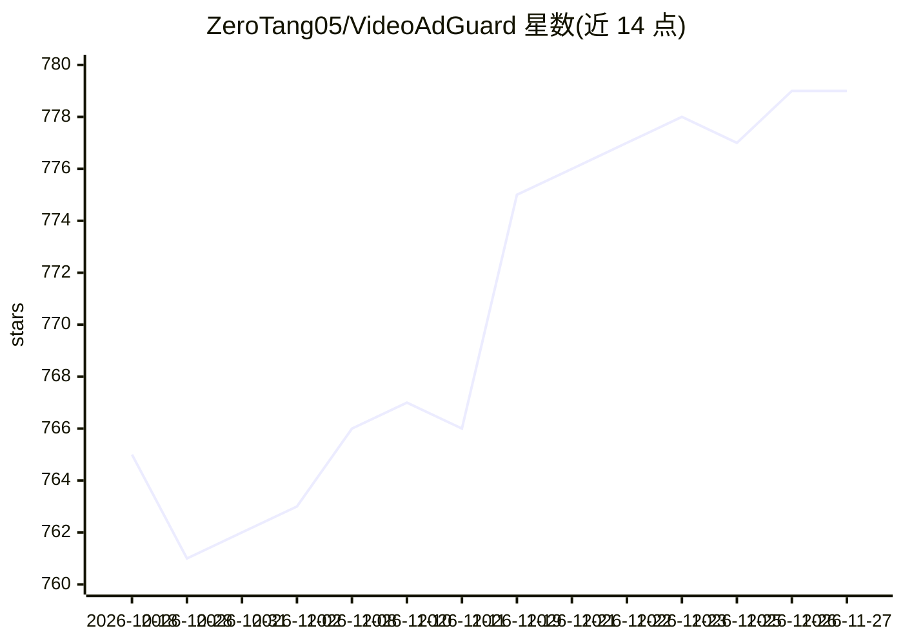

# ZeroTang05/VideoAdGuard

⭐ 779 · TypeScript · GPL-2.0 · 推送 2026-11-26 · [GitHub](https://github.com/ZeroTang05/VideoAdGuard) · [官网](https://vag.xiaobaozi.cn) · 个人维护 · 中文 README

**B站浏览器插件：用大语言模型检测并跳过视频植入广告**

面向B站用户的浏览器扩展（Edge/Chrome/Firefox），另有油猴脚本版本（已声明不再维护）。插件读取视频字幕（无字幕视频可用Groq的Whisper模型做音频识别），交由用户配置的大语言模型分析并定位植入广告区间，检测到广告后在播放器显示一键跳过按钮，支持自动跳过。检测结果本地缓存，并有云端缓存供社区共享与反馈修正。需自行配置LLM API密钥方可工作，支持OpenAI/Anthropic兼容接口、System One接口及Ollama等本地模型。以GPLv2开源，可从商店安装或自行构建。

## 筛选速览

| 维度 | 判定 | 备注 |
|---|---|---|
| AI 角色 | `ai-native` | 本体是模型或模型工具 |
| 许可风险 | `viral` | GPL-2.0 |
| 部署形态 | `library` | 以包/库形式分发 |
| 模型依赖 | local-ok | 支持本地模型 |
| 硬件要求 | — | 无带数字的原话,不猜 |
| 安装摩擦 | `low` | 无编译、无系统依赖或容器化 |
| 成熟度 | — | 结构信号不足 |

## 能力要点

- 基于视频字幕的LLM植入广告检测，无字幕视频可用Groq音频识别
- 检测到广告后一键跳过，支持自动跳过与手动调整广告区间
- 本地缓存与云端社区共享检测结果，附AI文案标注与AI评论屏蔽功能
- 支持OpenAI/Anthropic兼容、System One接口及Ollama、LM Studio、vLLM等本地模型接入

## 适用场景

- 看B站视频时自动识别并跳过植入/口播广告
- 配置本地Ollama模型在保护隐私的情况下做广告检测
- 标记疑似AI文案并屏蔽疑似AI生成的评论

## 场景标签

`AI 写作` · 领域:内容生成

## 证据(README 行号)

> L5: VideoAdGuard 是一个基于大语言模型的B站视频植入广告检测工具，能够自动识别B站视频中的植入广告内容，并提供跳过广告的功能。
> L44: - 🎯 **精准识别**：采用大语言模型分析视频字幕，准确定位植入广告内容
> L116: 本插件需要配置大语言模型API才能正常工作。检测能力与大模型能力强相关，推荐使用性能更强的大模型。

## 星数曲线

2026-10-18 765 → 2026-11-27 779（+14）

---
*卡片 v1 · prompt 1.4 · 生成 2026-11-27 · 置信度 high · 依据 README sha `408199943b06` · [字段定义](../../DATASET.md)*
