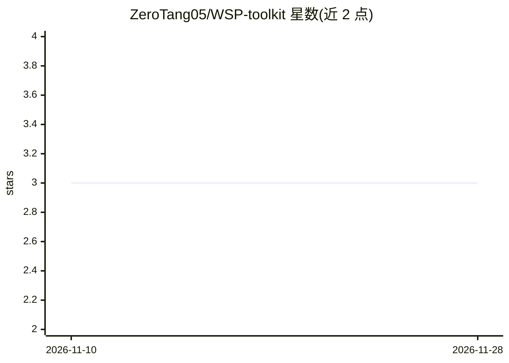

# ZeroTang05/WSP-toolkit

⭐ 3 · Python · Apache-2.0 · 推送 2026-11-10 · [GitHub](https://github.com/ZeroTang05/WSP-toolkit) · 个人维护

**给 AI 客户端与研究者的权重空间编程工具集：检查、编辑、评估开源模型**

将 PyTorch、Hugging Face Transformers、Safetensors、PEFT 及已发表的研究方法封装为工具，供 AI 客户端（通过本地 MCP 服务器）与研究者使用：读取权重与内部激活、创建可回滚的补丁编辑、记录激活与注意力热图、执行 Path Patching/ACDC/EAP 等电路追踪、ROME/MEMIT 事实编辑、TIES/DARE 更新合并、SliceGPT/GPTQ/AWQ 量化与层剪枝导出。设计目录覆盖 34 个工具条目与 47 个命名方法，能力针对 Llama、Qwen3、Qwen3.5、DistilBERT 分别验证。需 Python 3.10+，从源码安装，示例可在 CPU 上运行。

## 筛选速览

| 维度 | 判定 | 备注 |
|---|---|---|
| AI 角色 | `ai-native` | 本体是模型或模型工具 |
| 许可风险 | `permissive` | Apache-2.0 |
| 部署形态 | `library` | 以包/库形式分发 |
| 模型依赖 | — | README 未给出锁定关系 |
| 硬件要求 | — | 无带数字的原话,不猜 |
| 安装摩擦 | `low` | 无编译、无系统依赖或容器化 |
| 成熟度 | — | 结构信号不足 |

## 能力要点

- 同一套工具定义同时暴露为本地 MCP 服务器与 Python 注册表
- 支持 ROME/MEMIT 事实编辑、TIES/DARE 合并、低秩压缩与量化剪枝
- 编辑以独立补丁保存并携带指纹，可创建/重放/导出/回滚
- 在 GSM8K 全量 1,319 题上报告了 TIES 合并更新的对比实验结果

## 适用场景

- 让 AI agent 携带工具对目标模型做权重检查与可逆编辑
- 研究模型内部机制：记录激活、追踪预测路径、绘制电路图
- 合并多个训练更新并评估其对基准成绩的影响
- 导出更小的检查点或训练 LoRA 适配器

## 场景标签

`微调` `模型量化` `模型评测` · 领域:评测与运维

## 证据(README 行号)

> L5: **Give an AI model tools to inspect, edit, and evaluate another model.**
> L7: WSP stands for **Weight-Space Programming**. The toolkit wraps PyTorch, Hugging Face Transformers, Safetensors, PEFT

## 星数曲线

2026-11-10 3 → 2026-11-28 3（+0）

---
*卡片 v1 · prompt 1.4 · 生成 2026-11-22 · 置信度 mid · 依据 README sha `3dba179117a5` · [字段定义](../../DATASET.md)*
