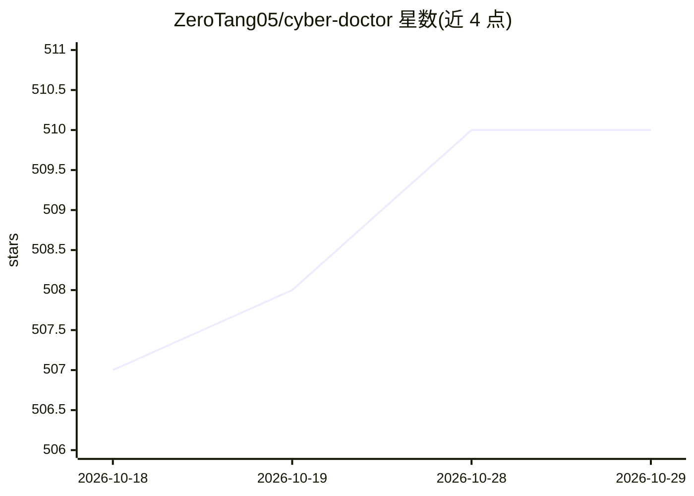

# ZeroTang05/cyber-doctor

⭐ 510 · Python · GPL-3.0 · 推送 2026-10-27 · [GitHub](https://github.com/ZeroTang05/cyber-doctor) · 组织维护 · 中文 README

**给关心健康的用户：可本地搭建的多模态医疗问答智能体**

东南大学暑期实训课程产出的医疗健康领域多模态大模型智能体「赛博华佗」：以 Gradio 构建 Web 界面，通过 AI 智能体调度多个模型，提供疾病初诊问答、病历/药品说明书图片识别、PPT/Word 生成、多轮对话、语音输入输出等功能。知识增强方面支持 Neo4j 知识图谱、本地文件知识库与联网爬虫检索（RAG）。API 支持所有兼容 OpenAI SDK 接口的服务及 Ollama 本地模型；知识图谱功能需另行安装 Neo4j。作者自述项目功能较聚合、知识图谱处理仍有优化空间。

## 筛选速览

| 维度 | 判定 | 备注 |
|---|---|---|
| AI 角色 | `ai-native` | 本体是模型或模型工具 |
| 许可风险 | `viral` | GPL-3.0 |
| 部署形态 | `library` | 以包/库形式分发 |
| 模型依赖 | local-ok | 支持本地模型 |
| 硬件要求 | — | 无带数字的原话,不猜 |
| 安装摩擦 | `low` | 无编译、无系统依赖或容器化 |
| 成熟度 | — | 结构信号不足 |

## 能力要点

- 多模态整合：图片识别、视频/图片/PPT/Word 生成、语音输入输出
- Neo4j 知识图谱 + 文件知识库 + 联网爬虫三种 RAG 增强路径
- 支持所有兼容 OpenAI SDK 的 API 与 Ollama 本地模型
- Gradio Web 界面，python app.py 一键启动

## 适用场景

- 搭建个人健康助手做疾病初诊与专业问答
- 上传病历或药品说明书图片进行识别分析
- 配置自有知识库或领域知识图谱做专业领域问答

## 场景标签

`聊天机器人` `RAG` `知识图谱` `多模态` · 领域:对话与助手

## 证据(README 行号)

> L14: 医疗资源不平衡一直以来是社会关注的重点问题，它导致众多医疗不公平事件发生。在相对落后地区的人们想要获得优秀的医疗资源往往需要前往一线城市，这不仅费时费力费钱，而且极大的影响了他们的接受医疗救助的基本权利。当前多模态大语言模型不断发
> L24: - **多功能多模态整合，借助AI智能体判断任务的种类，将多个模型整合工作，解决复杂问题。**
> L41: |知识图谱增强|支持配置相关领域的neo4j知识图谱，用专业知识改善大模型输出|

## 星数曲线

2026-10-18 507 → 2026-10-29 510（+3）

---
*卡片 v1 · prompt 1.4 · 生成 2026-10-28 · 置信度 mid · 依据 README sha `758acbb4db59` · [字段定义](../../DATASET.md)*
