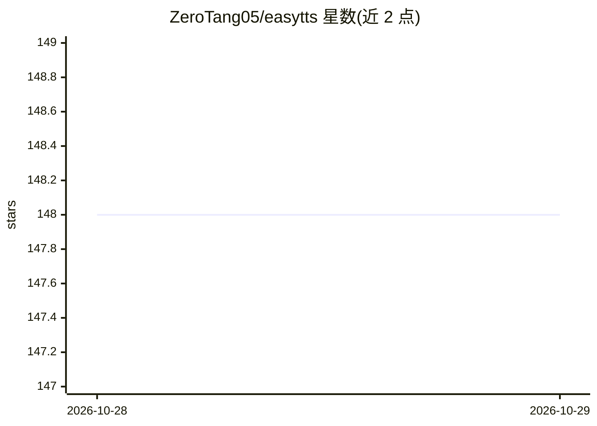

# ZeroTang05/easytts

⭐ 148 · Python · 推送 2026-10-20 · [GitHub](https://github.com/ZeroTang05/easytts) · 个人维护 · 中文 README

**一键将小说转为多人有声书的 TTS 服务与 GUI 客户端**

基于 Flask 的文本转语音服务，结合说话人识别实现多角色有声小说生成：用正则规则对文本分句，用 RoBERTa（中文 chinese-roberta-wwm-ext-large）识别对话说话人，为不同角色分配不同语音并合成。提供 RESTful API 与 PyQt6 跨平台 GUI。要求 Python 3.11 及以下、CUDA 支持、8GB 以上内存，模型文件需从 Hugging Face 手动下载放置。README 声明项目仍处于早期阶段。

## 筛选速览

| 维度 | 判定 | 备注 |
|---|---|---|
| AI 角色 | `ai-native` | 本体是模型或模型工具 |
| 许可风险 | `none` | — |
| 部署形态 | `None` |  |
| 模型依赖 | — | README 未给出锁定关系 |
| 硬件要求 | — | 无带数字的原话,不猜 |
| 安装摩擦 | `low` | 无编译、无系统依赖或容器化 |
| 成熟度 | `idea` | |

## 能力要点

- 基于 RoBERTa 的对话说话人识别
- 正则规则分句与引号检测等文本预处理
- Flask RESTful API + PyQt6 GUI 客户端
- 为不同角色分配不同语音的多角色合成

## 适用场景

- 把小说文本一键生成多人有声书
- 通过 GUI 或 API 调用多说话人语音合成
- 自动识别小说对话中的说话人并分配音色

## 场景标签

`语音合成` · 领域:内容生成

## 证据(README 行号)

> L6: 一个基于Flask的智能文本转语音(TTS)服务，集成了说话人识别功能，支持一键式多角色对话生成。
> L15: - 说话人识别：基于BERT的说话人识别模型，可自动识别对话中的说话人

## 星数曲线

2026-10-28 148 → 2026-10-29 148（+0）

---
*卡片 v1 · prompt 1.4 · 生成 2026-10-28 · 置信度 high · 依据 README sha `0e5d436601b0` · [字段定义](../../DATASET.md)*
