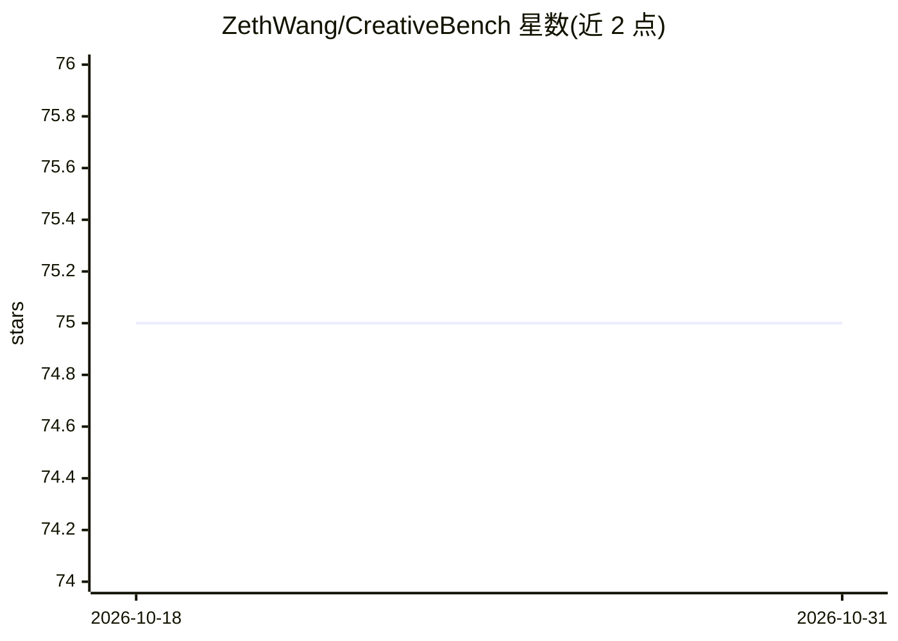

# ZethWang/CreativeBench

⭐ 75 · Python · MIT · 推送 2026-06-29 · [GitHub](https://github.com/ZethWang/CreativeBench) · 组织维护

**创造性代码生成的基准与数据合成框架（论文官方代码）**

论文 CreativeBench 的官方实现：面向创造性代码生成的基准与数据合成框架，含两条流水线。Combo 通过跨领域代码重组加沙盒反馈合成新题目并生成验证测试；Explore 通过渐进约束自博弈演化题目并计算创造性分数。提供 JSONL 格式数据集（题目、参考解、测试、难度），可适配其他语言或模型。沙盒实现 MultiLanguageSandbox 尚未随公开发布包含，需自行运行沙盒服务。

## 筛选速览

| 维度 | 判定 | 备注 |
|---|---|---|
| AI 角色 | `ai-knowledge` | 知识聚合/清单类 |
| 许可风险 | `permissive` | MIT |
| 部署形态 | `None` |  |
| 模型依赖 | — | README 未给出锁定关系 |
| 硬件要求 | — | 无带数字的原话,不猜 |
| 安装摩擦 | `low` | 无编译、无系统依赖或容器化 |
| 成熟度 | `idea` | |

## 能力要点

- Combo：跨领域代码重组 + 沙盒反馈合成新题与验证测试
- Explore：渐进约束自博弈演化题目并计算创造性分数
- JSONL 数据字段含参考解、公开测试与完整测试
- 设计面向可复现与可扩展，可适配其他语言或模型

## 适用场景

- 复现论文的数据集生成流水线
- 为创造性代码生成评测构造带验证测试的题目
- 基于渐进约束挖掘模型解法的多样性

## 场景标签

`模型评测` · 领域:评测与运维

## 证据(README 行号)

> L18:  Benchmarking and Enhancing Machine Creativity via Self-Evolving Challenges
> L32: CreativeBench is an open-source benchmark and data synthesis framework for **creative code generation**, featuring 

## 星数曲线

2026-10-18 75 → 2026-10-31 75（+0）

---
*卡片 v1 · prompt 1.4 · 生成 2026-10-24 · 置信度 high · 依据 README sha `650161894556` · [字段定义](../../DATASET.md)*
