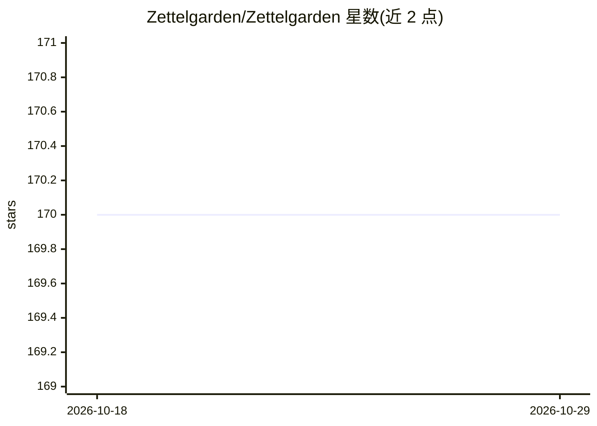

# Zettelgarden/Zettelgarden

⭐ 170 · TypeScript · MIT · 推送 2026-08-11 · [GitHub](https://github.com/Zettelgarden/Zettelgarden) · [官网](https://zettelgarden.com) · 个人维护

**自托管的 zettelkasten 知识管理系统，附 AI 辅助摘要与语义搜索**

基于 zettelkasten 方法论的开源知识管理系统：原子卡片、双向链接、任务、RSS 订阅、文件管理与层级组织，全部数据存于单个 SQLite 文件，支持 Docker Compose 一键自托管与本地优先同步引擎（进行中）。AI 为可选增强：通过 OpenAI 兼容端点提供向量语义搜索、LLM 实体识别与内容摘要，另含面向 Claude 的 MCP 服务器。PRO 功能在关闭 Stripe 时默认解锁；项目自述仍在活跃演进，功能可能变化。

## 筛选速览

| 维度 | 判定 | 备注 |
|---|---|---|
| AI 角色 | `ai-enhanced` | 去掉 AI 部分产品仍成立 |
| 许可风险 | `permissive` | MIT |
| 部署形态 | `self-host` | docker 或自建部署 |
| 模型依赖 | — | README 未给出锁定关系 |
| 硬件要求 | — | 无带数字的原话,不猜 |
| 安装摩擦 | `low` | 无编译、无系统依赖或容器化 |
| 成熟度 | `idea` | |

## 能力要点

- 原子卡片 + [[wiki-links]] 双向链接与知识图谱
- 可选 LLM 集成：向量搜索、实体识别、摘要（OpenAI 兼容端点，支持本地模型）
- SQLite 单文件存储，单 Docker 容器自托管
- 本地优先同步引擎与 Tauri v2 桌面壳（进行中）

## 适用场景

- 自托管搭建个人 zettelkasten 笔记与任务系统
- 在笔记库上做语义搜索与实体抽取
- 通过 RSS 订阅并把文章转为知识卡片

## 场景标签

`知识库管理` `语义搜索` · 领域:知识与检索

## 证据(README 行号)

> L5: Zettelgarden is a self-hosted, open-source knowledge management system built on
> L17: - **AI as an augmentation** — optional LLM integration (OpenAI-compatible

## 星数曲线

2026-10-18 170 → 2026-10-29 170（+0）

---
*卡片 v1 · prompt 1.4 · 生成 2026-10-22 · 置信度 mid · 依据 README sha `3bc1710114a3` · [字段定义](../../DATASET.md)*
