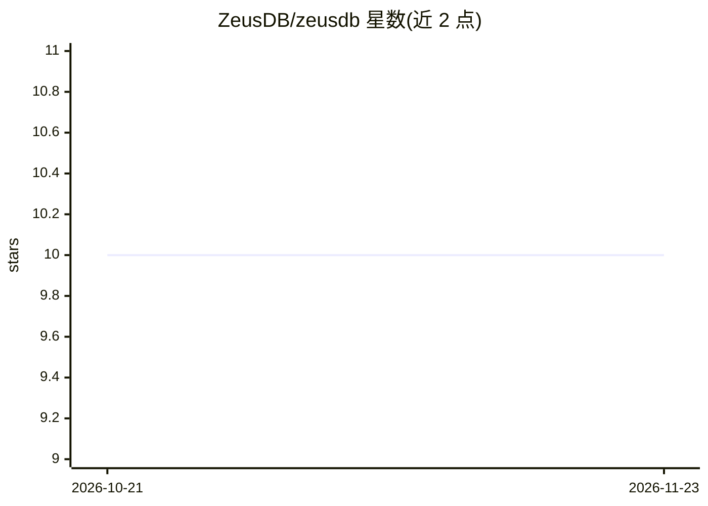

# ZeusDB/zeusdb

⭐ 10 · Python · Apache-2.0 · 推送 2026-08-26 · [GitHub](https://github.com/ZeusDB/zeusdb) · [官网](https://docs.zeusdb.com) · 组织维护

**面向 RAG 与相似度检索的高性能向量数据库**

基于 Rust 后端、提供 Python API 的向量数据库，实现基于 HNSW 的近似最近邻（ANN）搜索与乘积量化（PQ）压缩存储，支持 NumPy 等输入格式、元数据过滤、索引持久化与跨系统重载。面向数据团队与工程师的向量检索、混合搜索与推荐场景，README 提及适用于 RAG 流水线中的语义上下文检索；通过 uv 或 pip 安装，采用 Apache 2.0 许可。

## 筛选速览

| 维度 | 判定 | 备注 |
|---|---|---|
| AI 角色 | `ai-ecosystem` | LLM/agent 周边工具 |
| 许可风险 | `permissive` | Apache-2.0 |
| 部署形态 | `library` | 以包/库形式分发 |
| 模型依赖 | — | README 未给出锁定关系 |
| 硬件要求 | — | 无带数字的原话,不猜 |
| 安装摩擦 | `low` | 无编译、无系统依赖或容器化 |
| 成熟度 | — | 结构信号不足 |

## 能力要点

- HNSW 近似最近邻搜索与乘积量化（PQ）存储压缩
- Python API 实现向量添加与相似度检索，支持 NumPy 输入
- 索引、元数据与量化向量的保存/重载与元数据过滤
- Rust 后端支持内存到磁盘持久化的切换

## 适用场景

- 为 RAG 应用构建语义检索层
- 文档搜索与推荐引擎的向量相似度检索
- 高维嵌入数据的持久化存储与实时查询

## 场景标签

`向量数据库` `语义搜索` · 领域:知识与检索

## 证据(README 行号)

> L43: ZeusDB Vector Database is a high-performance, Rust-powered vector database built for fast and scalable similarity s
> L45: Whether you're powering document search, enabling natural language interfaces, or building custom vector-based tool

## 星数曲线

2026-10-21 10 → 2026-11-23 10（+0）

---
*卡片 v1 · prompt 1.4 · 生成 2026-11-20 · 置信度 high · 依据 README sha `dca79e5a005c` · [字段定义](../../DATASET.md)*
