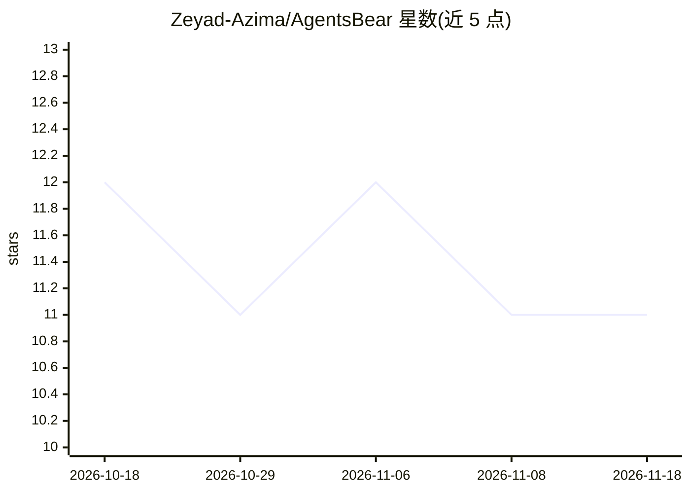

# Zeyad-Azima/AgentsBear

⭐ 11 · JavaScript · MIT · 推送 2026-04-05 · [GitHub](https://github.com/Zeyad-Azima/AgentsBear) · 个人维护

**用 YAML 声明式定义并运行多 Agent 流水线的 CLI+Web UI 框架**

AgentsBear 提供一个 CLI 与 Web UI，用户在单个 agent.yaml 文件中声明多 Agent 流水线的步骤、并行/循环/条件结构、提示词、输出 schema 与工具，由其编译并在 deepagents 与 LangGraph 之上执行。支持 shell/HTTP/导入类自定义工具、步骤间上下文传递、JSON/markdown 输出落盘，内置拖拽式可视化构建器、运行监控与日志查看。运行需 Python 3.11+ 及至少一个 LLM API key 或本地 Ollama 实例；安装方式当前为源码克隆。

## 筛选速览

| 维度 | 判定 | 备注 |
|---|---|---|
| AI 角色 | `ai-ecosystem` | LLM/agent 周边工具 |
| 许可风险 | `permissive` | MIT |
| 部署形态 | `self-host` | docker 或自建部署 |
| 模型依赖 | local-ok | 支持本地模型 |
| 硬件要求 | — | 无带数字的原话,不猜 |
| 安装摩擦 | `low` | 无编译、无系统依赖或容器化 |
| 成熟度 | — | 结构信号不足 |

## 能力要点

- 单文件 YAML 声明并行、顺序组、条件分支、for-each 循环与 shell 步骤
- 支持 OpenAI、Anthropic、Gemini、Mistral、Groq 及 Ollama 兼容本地模型作为后端
- YAML 内直接定义 shell/HTTP/导入型工具，无需编写 Python
- 内置拖拽式流水线构建器、运行监控与日志查看的 Web UI

## 适用场景

- 把安全扫描、IOC 提取、报告生成等多步 Agent 流程写成可版本管理的 YAML
- 在本地离线环境用 Ollama 运行可复现的多 Agent 批量任务
- 团队间通过共享单个 agent.yaml 文件复现相同流水线
- 通过可视化画布搭建和监控 Agent 流水线

## 场景标签

`Agent 框架` `多智能体` `工作流自动化` · 领域:Agent 开发

## 证据(README 行号)

> L7:  A CLI + Web UI framework for building fully autonomous AI agent pipelines from declarative YAML files.
> L17: AgentsBear lets you describe a multi-agent AI pipeline in a single `.yaml` file — the tools, prompts, parallelism, 
> L103: **Requirements:** Python 3.11 or higher, and at least one LLM API key (or a local Ollama instance).

## 星数曲线

2026-10-18 12 → 2026-11-18 11（-1）

---
*卡片 v1 · prompt 1.4 · 生成 2026-11-18 · 置信度 mid · 依据 README sha `00d560390235` · [字段定义](../../DATASET.md)*
