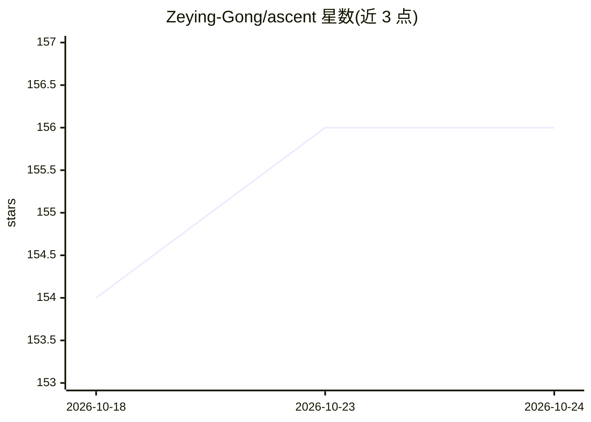

# Zeying-Gong/ascent

⭐ 156 · Python · MIT · 推送 2026-01-11 · [GitHub](https://github.com/Zeying-Gong/ascent) · [官网](https://zeying-gong.github.io/projects/ascent/) · 组织维护

**零样本多层目标导航框架：LLM 驱动的楼层感知粗到细探索**

ASCENT 是 RAL'26 论文的官方代码实现，做零样本物体目标导航（ObjectNav）：在多层建筑场景中，用 LLM（Qwen2.5-7B）驱动的由粗到细探索策略，结合楼层感知完成在线导航决策。感知侧集成 GroundingDINO、D-FINE、MobileSAM、RAM++、RedNet 等模型权重，在 Habitat 仿真环境的 HM3D/MP3D 数据集上评测。安装需 Conda 环境、Habitat-Sim/Lab 0.3.1 与 CUDA 11.8，真实世界部署代码尚未发布。面向具身智能研究人员。

## 筛选速览

| 维度 | 判定 | 备注 |
|---|---|---|
| AI 角色 | `ai-native` | 本体是模型或模型工具 |
| 许可风险 | `permissive` | MIT |
| 部署形态 | `library` | 以包/库形式分发 |
| 模型依赖 | — | README 未给出锁定关系 |
| 硬件要求 | — | 无带数字的原话,不猜 |
| 安装摩擦 | `medium` | 含编译或系统依赖之一 |
| 成熟度 | — | 结构信号不足 |

## 能力要点

- LLM 驱动的粗到细探索与楼层感知导航策略
- 在 HM3D/MP3D 数据集上零样本评测的完整流程
- 集成 GroundingDINO/D-FINE/MobileSAM 等多个感知模型权重

## 适用场景

- 在 Habitat 中复现论文的物体目标导航实验
- 研究多层场景下的零样本导航策略
- 基于该框架做具身导航方法的对比或扩展实验

## 场景标签

 · 领域:具身智能/机器人导航

## 证据(README 行号)

> L1: Stairway to Success: An Online Floor-Aware Zero-Shot Object-Goal Navigation Framework via LLM-Driven Coarse-to-Fine 
> L162: Run VLM servers
> L171: python -u -m ascent.run --config-name=eval_ascent_hm3d.yaml

## 星数曲线

2026-10-18 154 → 2026-10-24 156（+2）

---
*卡片 v1 · prompt 1.4 · 生成 2026-10-23 · 置信度 mid · 依据 README sha `170c166b51a7` · [字段定义](../../DATASET.md)*
