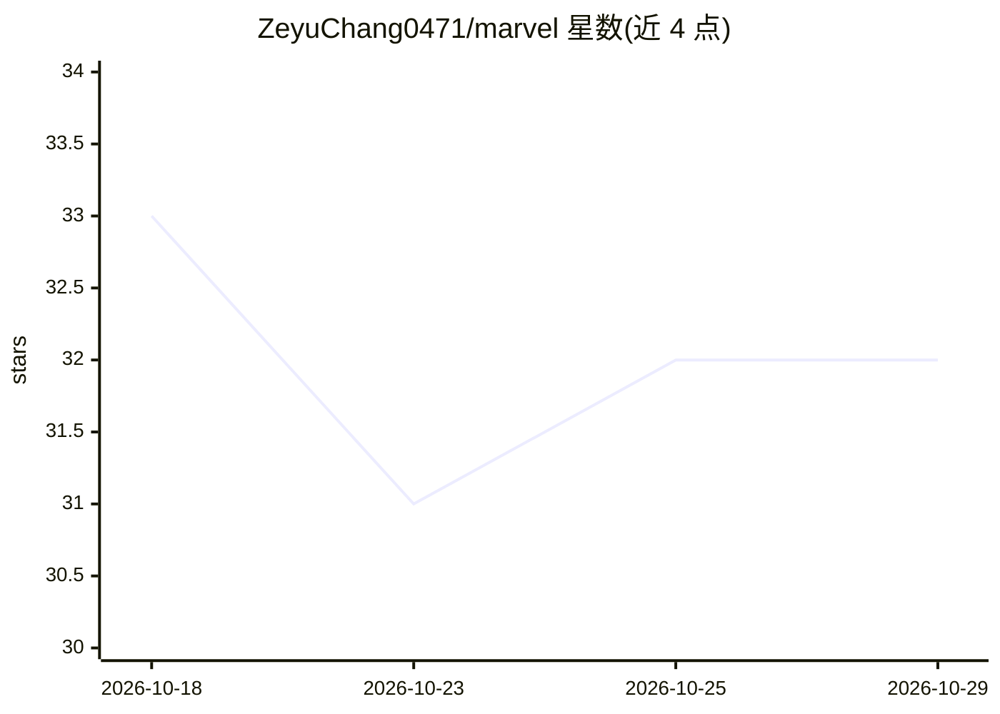

# ZeyuChang0471/marvel

⭐ 32 · Python · Apache-2.0 · 推送 2026-10-22 · [GitHub](https://github.com/ZeyuChang0471/marvel) · 个人维护 · 中文 README

**A股多Agent投研分析系统：9位AI分析师辩论后输出多空决策报告**

基于 TradingAgents 框架的 A 股特化 fork，运行 14 阶段流水线：9 个分析师（含政策/游资/解禁/量价/宏观等 A 股特化角色）生成研报，经质量门控、多空辩论、交易与风控评估，输出中文完整决策报告。数据全部来自 mootdx、东方财富、新浪等免费国内源，无需 API Key；LLM 需自备 API Key（支持 9 个供应商），每次分析约 30-50 次调用。提供 CLI、Streamlit Web UI 与 Docker 部署，SQLite 断点续跑。整体按非商业混合许可（Apache-2.0 + PolyForm NC）分发，禁止商用。

## 筛选速览

| 维度 | 判定 | 备注 |
|---|---|---|
| AI 角色 | `ai-native` | 本体是模型或模型工具 |
| 许可风险 | `permissive` | Apache-2.0 |
| 部署形态 | `desktop` | 安装包/桌面程序 |
| 模型依赖 | local-ok | 支持本地模型 |
| 硬件要求 | — | 无带数字的原话,不猜 |
| 安装摩擦 | `low` | 无编译、无系统依赖或容器化 |
| 成熟度 | — | 结构信号不足 |

## 能力要点

- 9 个分析师角色（含 5 个 A 股特化角色：政策/游资/解禁/量价/宏观）
- 14 阶段流水线：分析师→质量门控→多空辩论→交易→风控→决策
- 数据源全免费直连（mootdx/东财/新浪/同花顺等），无积分墙
- CLI / Streamlit Web UI / Docker 三种运行方式，支持 SQLite 断点续跑

## 适用场景

- 输入 A 股代码一键生成含多空辩论与风控的完整分析报告
- 通过 Web UI 无代码运行多 Agent 投研分析并导出 Markdown/PDF
- 量化研究者基于多 Agent 架构做 A 股个股深度研究（仅供学习研究）

## 场景标签

`多智能体` `金融量化` · 领域:Agent 开发

## 证据(README 行号)

> L59: 进度条共 **14 个阶段**：9 个分析师 → 质量门控 → 投研辩论 → 交易 → 风控 → 最终决策
> L268: - **完整报告**：信号卡片（Buy/Overweight/Hold/Underweight/Sell 5 档）、9 份分析师报告、数据质量门控、多空辩论、风控评估

## 星数曲线

2026-10-18 33 → 2026-10-29 32（-1）

---
*卡片 v1 · prompt 1.4 · 生成 2026-10-26 · 置信度 mid · 依据 README sha `1c15139c4cf6` · [字段定义](../../DATASET.md)*
