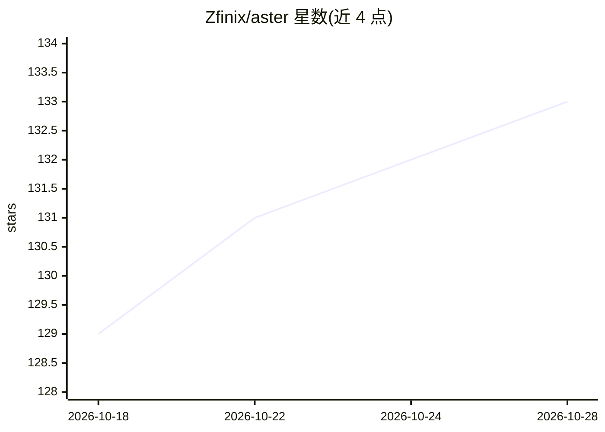

# Zfinix/aster

⭐ 133 · Rust · Apache-2.0 · 推送 2026-10-26 · [GitHub](https://github.com/Zfinix/aster) · [官网](https://withaster.dev) · 个人维护

**可自托管的开源终端编程 agent，自带模型与密钥**

Rust 编写的终端编程代理（agent）：读取代码、回答问题、编辑文件、执行命令与审查变更，工作流为 Hypothesize→Retrieve→Verify→Shape 四步，其中验证环节由第二次模型调用试图反驳候选缺陷，低于置信阈值的发现被过滤。支持任意 OpenAI 兼容端点（OpenRouter、OpenAI、Groq、Anthropic 及本机 Ollama/vLLM/llama.cpp），会话、记忆、技能以本地文件存储。提供终端 TUI、浏览器界面、VS Code/Zed 集成与桌面应用，并有五级权限模式与命令沙箱。README 声明项目处于早期阶段。

## 筛选速览

| 维度 | 判定 | 备注 |
|---|---|---|
| AI 角色 | `ai-native` | 本体是模型或模型工具 |
| 许可风险 | `permissive` | Apache-2.0 |
| 部署形态 | `library` | 以包/库形式分发 |
| 模型依赖 | local-ok | 支持本地模型 |
| 硬件要求 | — | 无带数字的原话,不猜 |
| 安装摩擦 | `low` | 无编译、无系统依赖或容器化 |
| 成熟度 | `idea` | |

## 能力要点

- 四步审查流程：廉价模型生成候选缺陷，第二次调用以反驳方式验证
- 会话/记忆/技能为本地纯文件，无托管控制面、无遥测
- 五级权限模式（plan/manual/auto/edit/yolo）与命令沙箱、风险命令暂停
- 同一配置可从终端、浏览器、VS Code/Zed 与桌面应用访问

## 适用场景

- 在终端用自选模型对代码库提问、修改与执行命令
- 在提交前对分支 diff 做带验证的缺陷审查并以 JSON 输出到 CI
- 通过本地模型（Ollama/vLLM 等）离线运行编程代理

## 场景标签

`编码 Agent` `代码审查` · 领域:编码与开发

## 证据(README 行号)

> L10: Aster is a terminal agent that reads your code, answers questions, edits files,
> L12: provider: OpenRouter, OpenAI, Groq, Anthropic, or a model running on your own
> L193: Review is Aster's most developed capability. It does not just ask a model to

## 星数曲线

2026-10-18 129 → 2026-10-28 133（+4）

---
*卡片 v1 · prompt 1.4 · 生成 2026-10-22 · 置信度 high · 依据 README sha `4fc3bb32aabe` · [字段定义](../../DATASET.md)*
