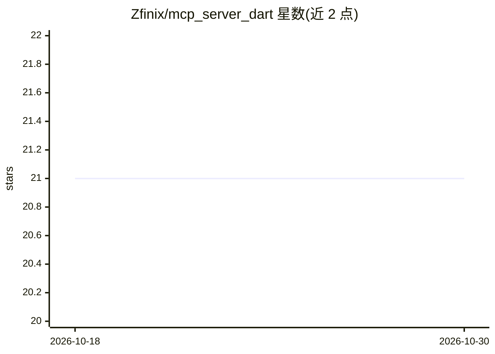

# Zfinix/mcp_server_dart

⭐ 21 · Dart · MIT · 推送 2026-05-20 · [GitHub](https://github.com/Zfinix/mcp_server_dart) · [官网](https://pub.dev/packages/mcp_server_dart) · 个人维护

**Dart 的 MCP 服务器框架：注解+代码生成构建 MCP 服务**

面向 Dart 开发者的 MCP（Model Context Protocol）服务器框架：用 @MCPTool、@MCPResource、@MCPPrompt、@MCPCompletion 等注解声明方法，经 build_runner 代码生成自动注册处理器；从方法签名自动提取参数并生成 JSON Schema。传输层支持 stdio、HTTP 与符合 MCP 2025-11-25 的 Streamable HTTP（含 SSE），HTTP 部分基于 Relic 框架，内置健康检查、状态端点、CORS 与日志中间件。可编译为独立二进制部署，支持 Claude Desktop 集成，附带多个示例与 MCP Inspector 测试流程。

## 筛选速览

| 维度 | 判定 | 备注 |
|---|---|---|
| AI 角色 | `ai-ecosystem` | LLM/agent 周边工具 |
| 许可风险 | `permissive` | MIT |
| 部署形态 | `self-host` | docker 或自建部署 |
| 模型依赖 | — | README 未给出锁定关系 |
| 硬件要求 | — | 无带数字的原话,不猜 |
| 安装摩擦 | `low` | 无编译、无系统依赖或容器化 |
| 成熟度 | — | 结构信号不足 |

## 能力要点

- 注解驱动 + build_runner 代码生成，自动注册工具/资源/提示词
- 从方法签名自动提取参数并生成 JSON Schema
- 支持 stdio / HTTP / Streamable HTTP（SSE）三种传输
- 基于 Relic 的 HTTP 服务，内置 /health、/status 端点与 CORS、日志中间件

## 适用场景

- 用 Dart 为 Claude 等 MCP 客户端编写工具服务器
- 把现有 Dart 函数封装为 LLM 可调用的 MCP 工具
- 以 HTTP/SSE 传输部署带健康检查的生产级 MCP 服务

## 场景标签

 · 领域:LLM 基础设施/MCP 开发框架

## 证据(README 行号)

> L9: A **developer-friendly MCP (Model Context Protocol) framework for Dart** with **annotations** and **code generation*
> L14: - **🔧 Code generation**: Automatic boilerplate generation using `build_runner` with extension-based registration

## 星数曲线

2026-10-18 21 → 2026-10-30 21（+0）

---
*卡片 v1 · prompt 1.4 · 生成 2026-10-28 · 置信度 mid · 依据 README sha `58e22badf015` · [字段定义](../../DATASET.md)*
