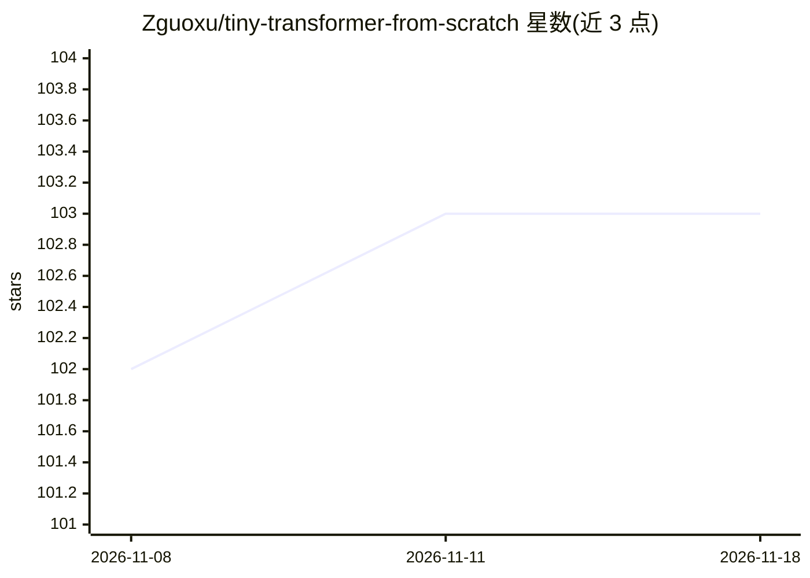

# Zguoxu/tiny-transformer-from-scratch

⭐ 103 · Jupyter Notebook · MIT · 推送 2026-11-02 · [GitHub](https://github.com/Zguoxu/tiny-transformer-from-scratch) · 个人维护 · 中文 README

**用 PyTorch 从零实现的小型 Transformer 英译中教学演示**

以单个 Python 文件从零实现 Transformer：手写缩放点积注意力、多头注意力、因果掩码、交叉注意力、编码器-解码器堆叠，不使用 nn.Transformer 或 nn.MultiheadAttention。内置 8 个英中句对，训练 100 个 epoch 后以自回归方式生成中文翻译，并保存损失曲线。面向已了解 PyTorch 基础、想跟踪 Transformer 内部计算的学习者，代码含中文注释，提供 Colab 浏览器运行与本地 venv 两种方式，仅需 CPU。限制：仅 8 个训练句对、固定词表，不演示泛化翻译能力。

## 筛选速览

| 维度 | 判定 | 备注 |
|---|---|---|
| AI 角色 | `ai-native` | 本体是模型或模型工具 |
| 许可风险 | `permissive` | MIT |
| 部署形态 | `library` | 以包/库形式分发 |
| 模型依赖 | — | README 未给出锁定关系 |
| 硬件要求 | — | 无带数字的原话,不猜 |
| 安装摩擦 | `low` | 无编译、无系统依赖或容器化 |
| 成熟度 | — | 结构信号不足 |

## 能力要点

- 单文件覆盖数据处理、模型、训练与生成全流程
- 手写注意力、因果掩码、交叉注意力，不使用 nn.Transformer
- 内置 8 个英中句对，无需下载数据集
- 支持 Google Colab 浏览器运行，无需本地安装

## 适用场景

- 跟随代码逐步理解 Transformer 各组件的计算过程
- 在浏览器里训练并观察英译中输出与损失曲线
- 修改注意力头数、层数或添加句对做学习实验

## 场景标签

`教程课程` · 领域:学习与行业

## 证据(README 行号)

> L13: A small Transformer implemented from scratch in PyTorch, covering token embeddings, positional encoding, multi-head
> L15: No `nn.Transformer` or `nn.MultiheadAttention`. Designed for learners who know the basics of PyTorch and want to fo

## 星数曲线

2026-11-08 102 → 2026-11-18 103（+1）

---
*卡片 v1 · prompt 1.4 · 生成 2026-11-17 · 置信度 mid · 依据 README sha `88dcc4dfd812` · [字段定义](../../DATASET.md)*
