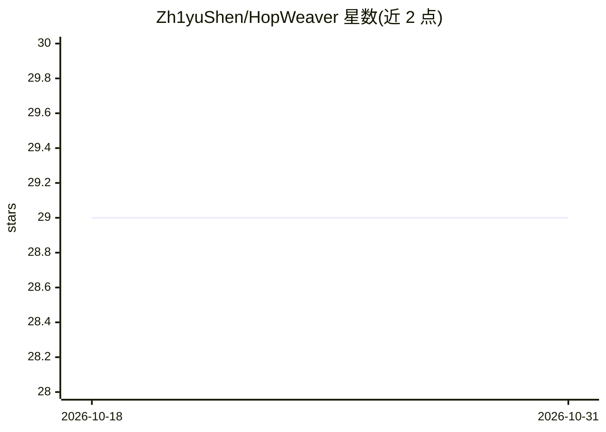

# Zh1yuShen/HopWeaver

⭐ 29 · Python · MIT · 推送 2026-04-07 · [GitHub](https://github.com/Zh1yuShen/HopWeaver) · 组织维护 · 中文 README

**从无结构语料自动合成跨文档多跳问答数据的框架**

基于 FlashRAG 框架构建的多跳问题合成与评测系统：从非结构化文本语料中自动生成跨文档的桥接式问题（实体连接）与比较式问题（属性分析），无需人工标注，面向标注资源稀缺的专业领域构建 MHQA 数据集。包含三维评测体系、自洽性评测、基于对比学习与 DeepSpeed 的 Reranker 训练模块；通过 YAML 配置 LLM API（OpenAI/Google 等）与 GTE 检索模型，以 Python 模块命令运行。

## 筛选速览

| 维度 | 判定 | 备注 |
|---|---|---|
| AI 角色 | `ai-ecosystem` | LLM/agent 周边工具 |
| 许可风险 | `permissive` | MIT |
| 部署形态 | `library` | 以包/库形式分发 |
| 模型依赖 | — | README 未给出锁定关系 |
| 硬件要求 | — | 无带数字的原话,不猜 |
| 安装摩擦 | `low` | 无编译、无系统依赖或容器化 |
| 成熟度 | — | 结构信号不足 |

## 能力要点

- 跨文档桥接问题与比较问题两条自动合成路径
- 三维评测体系与自洽性评测（self-consistency）
- 包含基于 DeepSpeed 的 Reranker 训练系统
- 支持 standard/diverse/rerank 三种检索器

## 适用场景

- 为专业领域构建多跳问答数据集而无需人工标注
- 批量生成并评测桥接/比较两类多跳问题
- 训练用于文档检索排序的 Reranker 模型

## 场景标签

`模型评测` · 领域:评测与运维

## 证据(README 行号)

> L85: The HopWeaver system is built on the FlashRAG framework and specifically designed for synthesizing and evaluating h
> L19: **HopWeaver automatically synthesizes authentic cross-document multi-hop questions from unstructured text corpora, 

## 星数曲线

2026-10-18 29 → 2026-10-31 29（+0）

---
*卡片 v1 · prompt 1.4 · 生成 2026-10-26 · 置信度 mid · 依据 README sha `342c2d4cea13` · [字段定义](../../DATASET.md)*
