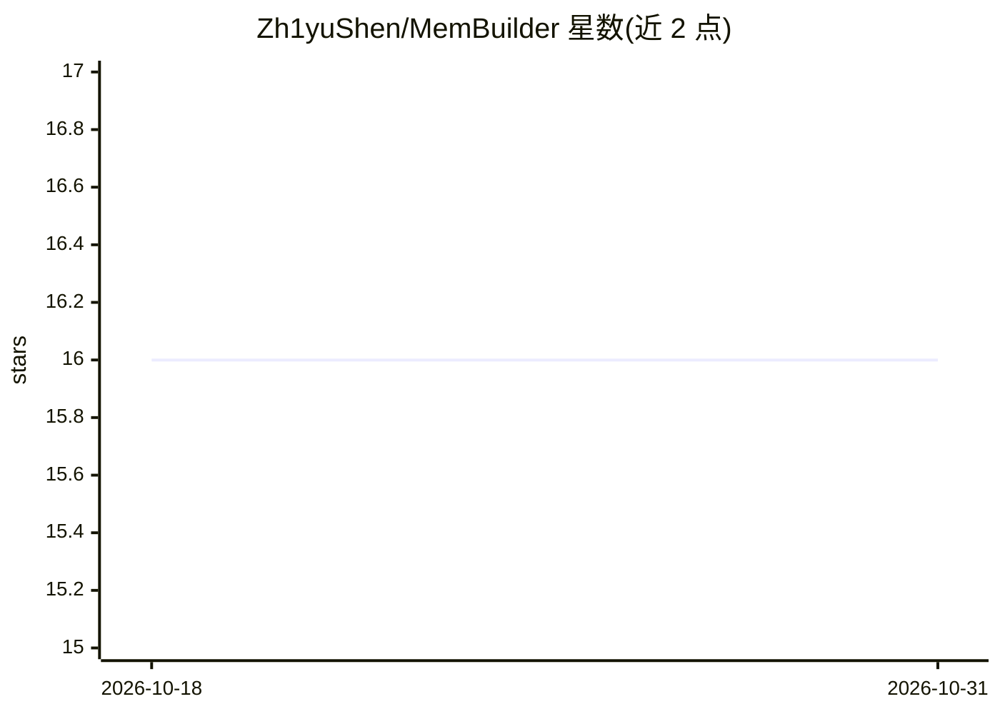

# Zh1yuShen/MemBuilder

⭐ 16 · Python · MIT · 推送 2026-07-07 · [GitHub](https://github.com/Zh1yuShen/MemBuilder) · [官网](https://arxiv.org/abs/2601.05488) · 组织维护 · 中文 README

**训练 LLM 构建多维长期对话记忆的 RL 框架（ACL 2026 论文代码）**

论文《Reinforcing LLMs for Long-Term Memory Construction via Attributed Dense Rewards》的代码实现：用 ADRPO（归因稠密奖励策略优化）训练 LLM 从对话中构建 Core/Episodic/Semantic/Procedural 四维记忆，通过合成会话级 QA 提供稠密中间奖励、按下游贡献加权梯度。流程含专家轨迹生成（Claude 4.5 Sonnet）、LLaMA-Factory 格式 SFT、veRL 格式 RL 训练与检查点转换；评测覆盖 LoCoMo/LongMemEval/PerLTQA 三个基准，支持 OpenAI 兼容 API 与自托管 vLLM 后端。面向能跑训练与评测流程的研究者和开发者，训练需多 GPU 环境。

## 筛选速览

| 维度 | 判定 | 备注 |
|---|---|---|
| AI 角色 | `ai-ecosystem` | LLM/agent 周边工具 |
| 许可风险 | `permissive` | MIT |
| 部署形态 | `library` | 以包/库形式分发 |
| 模型依赖 | local-ok | 支持本地模型 |
| 硬件要求 | — | 无带数字的原话,不猜 |
| 安装摩擦 | `low` | 无编译、无系统依赖或容器化 |
| 成熟度 | — | 结构信号不足 |

## 能力要点

- ADRPO：合成会话级 QA 稠密奖励 + 各记忆维度贡献归因的梯度加权
- 四维记忆架构（Core/Episodic/Semantic/Procedural）带各自编辑动作集
- SFT→RL 两阶段训练流水线，转换到 LLaMA-Factory 与 veRL 格式
- LoCoMo/LongMemEval/PerLTQA 三基准评测，支持 vLLM 自托管模型

## 适用场景

- 复现论文的长期记忆构建训练与评测流程
- 训练自己的记忆构建模型并接入对话系统
- 用强 API 模型先跑通记忆构建框架再决定是否训练

## 场景标签

`Agent 记忆` `强化学习` · 领域:Agent 开发

## 证据(README 行号)

> L9: MemBuilder trains LLMs to build **multi-dimensional long-term memory** from conversations. It uses **ADRPO** (Attrib
> L94: ### Step 0: Generate Expert Trajectories
> L139: ### Stage 2: ADRPO (Attributed Dense Reward Policy Optimization)

## 星数曲线

2026-10-18 16 → 2026-10-31 16（+0）

---
*卡片 v1 · prompt 1.4 · 生成 2026-10-30 · 置信度 high · 依据 README sha `fb159f46f06e` · [字段定义](../../DATASET.md)*
