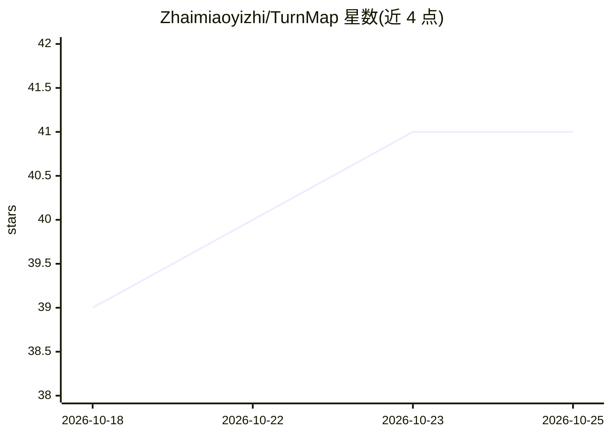

# Zhaimiaoyizhi/TurnMap

⭐ 41 · TypeScript · MIT · 推送 2026-07-16 · [GitHub](https://github.com/Zhaimiaoyizhi/TurnMap) · 个人维护 · 中文 README

**把网页 AI 对话转成可编辑思维导图的浏览器扩展**

Chromium Manifest V3 浏览器扩展（Chrome/Edge），把当前 AI 网站会话映射为可视化节点图：每个问答轮次成为节点，支持跳回原消息、编辑、连线、着色、折叠、标记重点、AI 摘要，并可导出为 JSON、Obsidian Canvas、OPML、Markdown、SVG、PNG 等格式。内置 13+ 站点适配（ChatGPT 为验证原生路线，其余多为 DOM 回退），另有 Prompt Workbench、答案迷你导图与本地优先存储。面向个人学习、长对话导航与知识整理，处于早期预览阶段，需从源码或 GitHub Release 手动安装。

## 筛选速览

| 维度 | 判定 | 备注 |
|---|---|---|
| AI 角色 | `ai-enhanced` | 去掉 AI 部分产品仍成立 |
| 许可风险 | `permissive` | MIT |
| 部署形态 | `library` | 以包/库形式分发 |
| 模型依赖 | — | README 未给出锁定关系 |
| 硬件要求 | — | 无带数字的原话,不猜 |
| 安装摩擦 | `low` | 无编译、无系统依赖或容器化 |
| 成熟度 | `idea` | |

## 能力要点

- 问答轮次→节点，右键跳回源消息，编辑/连线/着色/折叠
- 支持 ChatGPT、Gemini、Claude、DeepSeek、Kimi 等 13+ AI 站点适配
- 导出 TurnMap JSON、Obsidian Canvas/ vault、OPML、Markdown、SVG、PNG
- 本地优先存储与带变量填充、仅优化当前输入的 Prompt Workbench

## 适用场景

- 在长 AI 对话中导航、回顾与整理问答内容
- 把研究或写作型对话整理为可编辑知识图并导出到 Obsidian
- 在写作器旁管理和复用本地提示词模板

## 场景标签

`提示工程` `知识库管理` · 领域:Agent 开发

## 证据(README 行号)

> L7: TurnMap is a Chromium Manifest V3 browser extension for Chrome and Edge that maps the current AI conversation into a
> L31: - **Prompt Workbench**: manage reusable local prompts beside the ChatGPT composer, fill dynamic variables, optimize
> L34: - **Editable knowledge graph**: edit titles, summaries, tags, statuses, notes, hidden nodes, and relationship links

## 星数曲线

2026-10-18 39 → 2026-10-25 41（+2）

---
*卡片 v1 · prompt 1.4 · 生成 2026-10-25 · 置信度 high · 依据 README sha `423be3cd8978` · [字段定义](../../DATASET.md)*
