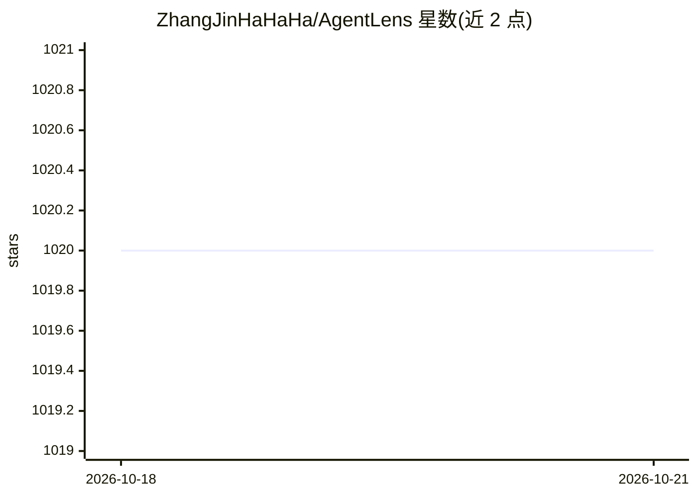

# ZhangJinHaHaHa/AgentLens

⭐ 1,015 · TypeScript · AGPL-3.0 · 推送 2026-08-24 · [GitHub](https://github.com/ZhangJinHaHaHa/AgentLens) · [官网](http://203.91.76.159/) · 个人维护 · 中文 README

**可信 AI Agent 交易市场与受治运行时平台（公开源分发）**

AgentLens 是 trust-first 的 AI Agent 市场与工作台：用户可发现任务型 Agent、比对信任证据与执行边界、按时间租用 Agent 并在平台提供的模型/搜索/文件/审计能力下运行。平台边界为“平台提供大脑与受治运行时，卖家提供专业 Agent”，租用不转移源码或永久所有权。仓库为脱敏公开分发，含市场与决策 UI、租赁制智能合约、六维审计参考实现、Agent Contract v3 等协议；生产编排、结算与部署逻辑保留在私有服务。

## 筛选速览

| 维度 | 判定 | 备注 |
|---|---|---|
| AI 角色 | `ai-ecosystem` | LLM/agent 周边工具 |
| 许可风险 | `dual` | AGPL-3.0 |
| 部署形态 | `library` | 以包/库形式分发 |
| 模型依赖 | — | README 未给出锁定关系 |
| 硬件要求 | — | 无带数字的原话,不猜 |
| 安装摩擦 | `low` | 无编译、无系统依赖或容器化 |
| 成熟度 | — | 结构信号不足 |

## 能力要点

- 租赁制智能合约：限时访问、评价、审计记录、申诉与声誉原语
- 六维评估审计参考实现：证据持久化、attestation 适配器与 ZK 验证组件
- R0-R4 运行时等级契约（隔离沙箱到 GPU 加速外置）
- 机器可读协议：Agent Contract v3 / Wire v1 / Provider / Runtime 契约

## 适用场景

- 浏览和比对带信任证据的任务型 Agent 并租用执行
- 作为卖家发布自己的 Agent 并注册托管 API
- 第三方 Agent 通过公开契约实现互操作与安全审查

## 场景标签

`Agent 框架` · 领域:Agent 开发

## 证据(README 行号)

> L14: **AgentLens** is a trust-first AI Agent marketplace and workspace. Users can discover task-specific Agents, compare
> L16: The platform follows a simple boundary: **AgentLens provides the brain and governed runtime; sellers provide the sp

## 星数曲线

2026-10-18 1,020 → 2026-10-21 1,020（+0）

---
*卡片 v1 · prompt 1.4 · 生成 2026-10-21 · 置信度 high · 依据 README sha `4d662dc72ebe` · [字段定义](../../DATASET.md)*
