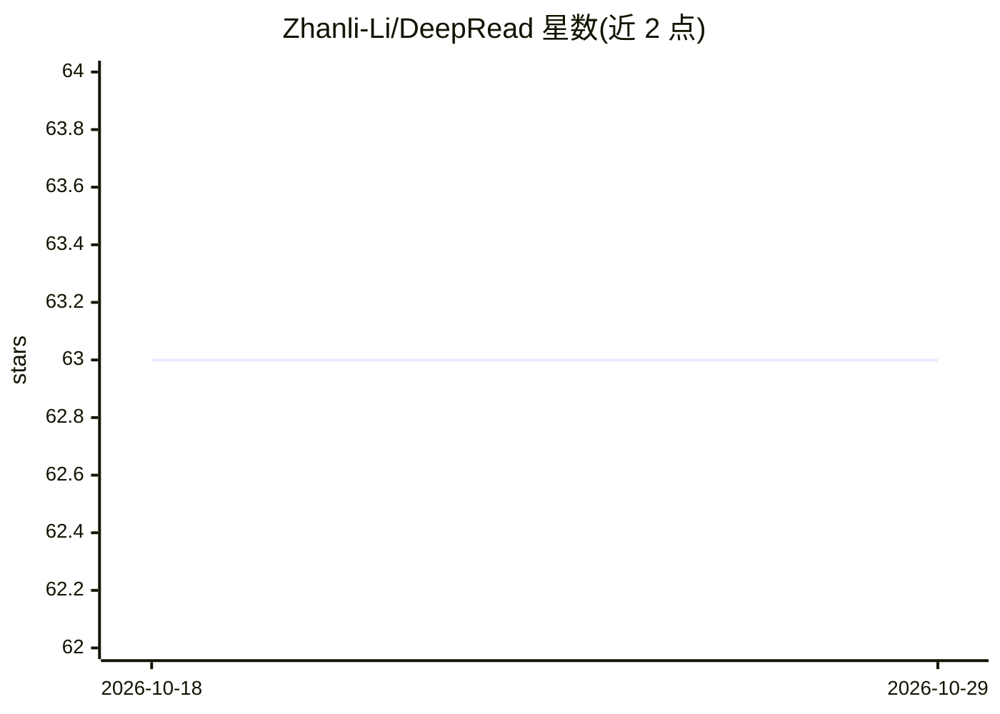

# Zhanli-Li/DeepRead

⭐ 63 · Python · Apache-2.0 · 推送 2026-06-03 · [GitHub](https://github.com/Zhanli-Li/DeepRead) · [官网](https://arxiv.org/abs/2602.05014) · 个人维护 · 中文 README

**文档结构感知的 RAG 代理：解析 PDF/Markdown 并回答问题**

论文 DeepRead 的官方实现。它是文档结构感知的 RAG agent：将 PDF（经 PaddleOCRVL OCR）或 Markdown 解析为结构化 corpus，agent 通过 BM25、regex、向量、混合与两阶段语义重排等检索工具回答问题，支持多文档提问、邻域扩展与多模态。LLM 通过 OpenAI 兼容 API（OpenRouter 环境变量）接入，向量与重排模式需 embedding/reranker API；BM25 模式无需嵌入。以 Python CLI（deepread.py）形式提供。

## 筛选速览

| 维度 | 判定 | 备注 |
|---|---|---|
| AI 角色 | `ai-native` | 本体是模型或模型工具 |
| 许可风险 | `permissive` | Apache-2.0 |
| 部署形态 | `None` |  |
| 模型依赖 | local-ok | 支持本地模型 |
| 硬件要求 | — | 无带数字的原话,不猜 |
| 安装摩擦 | `low` | 无编译、无系统依赖或容器化 |
| 成熟度 | — | 结构信号不足 |

## 能力要点

- PDF 经 PaddleOCRVL 转 Markdown 再生成结构化 corpus，保留标题/表格/阅读顺序
- 五种检索模式：BM25/regex/向量/混合/两阶段语义重排
- 多文档提问，以 (doc_id, node_id, paragraph_indexes) 形式返回引用
- PaddleOCRVL 通过 Docker 启动 vLLM 服务

## 适用场景

- 对长文档（年报、论文）做带结构引用的问答
- 跨多个文档比较并引用各自结论
- 在无嵌入条件下用 BM25 快速搭建文档问答

## 场景标签

`文档问答` `RAG` `文档解析` · 领域:知识与检索

## 证据(README 行号)

> L10: DeepRead is a document-structure-aware RAG agent. The code is organized around four explicit runtime boundaries: `a
> L247: @article{li2026deepread,

## 星数曲线

2026-10-18 63 → 2026-10-29 63（+0）

---
*卡片 v1 · prompt 1.4 · 生成 2026-10-24 · 置信度 high · 依据 README sha `6640ee3fc37d` · [字段定义](../../DATASET.md)*
