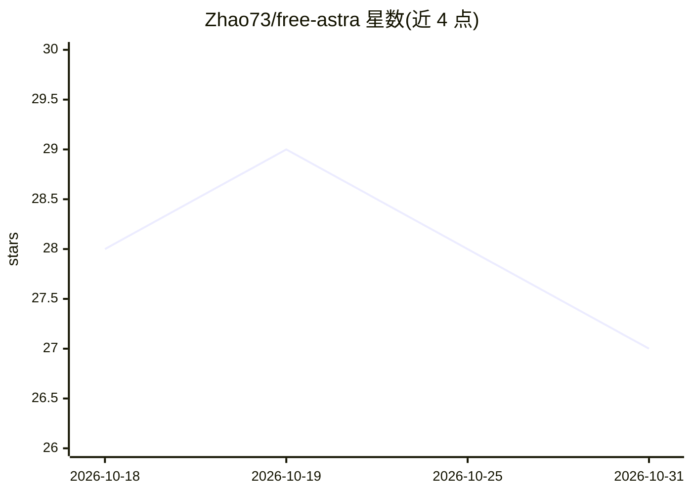

# Zhao73/free-astra

⭐ 27 · Python · MIT · 推送 2026-09-17 · [GitHub](https://github.com/Zhao73/free-astra) · 个人维护

**把 Prism 网页会话桥接进本地 Codex 免费用 GPT-6-Astra 的适配器**

单文件适配器，位于 Codex 前端：对 Codex 说 OpenAI Responses API，对 Prism 用浏览器 Cookie 认证的私有协议，按模型名分流（prism-* 自己应答，其余原样转发原上游）。提供 prism-astra/prism-sol/prism-terra 三个模型别名。面向无付费计划、只有免费 ChatGPT 账号的 Codex CLI 用户。要求 macOS/Linux、Python 3.9+ 与已登录的 codex CLI；会话 Cookie 约 12 小时过期，keep-alive 服务仅 macOS 可用。README 明示此用法未经 OpenAI 支持、可能违反服务条款，且无真实流式与 token 计量。

## 筛选速览

| 维度 | 判定 | 备注 |
|---|---|---|
| AI 角色 | `ai-ecosystem` | LLM/agent 周边工具 |
| 许可风险 | `permissive` | MIT |
| 部署形态 | `library` | 以包/库形式分发 |
| 模型依赖 | — | README 未给出锁定关系 |
| 硬件要求 | — | 无带数字的原话,不猜 |
| 安装摩擦 | `low` | 无编译、无系统依赖或容器化 |
| 成熟度 | — | 结构信号不足 |

## 能力要点

- 按模型名分流的前门适配器：prism-* 本地应答，其余请求原样转发
- Prism 模型白名单变动时自动回退并记录替换日志
- 会话过期自动重捕获（可选 chrome-use CLI），失败时快速报错
- session.json 以 chmod 600 存储本地 Cookie，不上传

## 适用场景

- 没有付费计划的开发者在本地 Codex 中调用 GPT-6-Astra 等模型
- 在同一 Codex 会话中混用 prism-* 与原有模型
- 了解逆向私有 Web 接口做协议适配的工程做法

## 场景标签

`模型网关` · 领域:Agent 开发

## 证据(README 行号)

> L70: free-astra is a single-file adapter that speaks the OpenAI Responses API to Codex
> L72: splits by model name: `prism-*` it answers itself, everything else it forwards

## 星数曲线

2026-10-18 28 → 2026-10-31 27（-1）

---
*卡片 v1 · prompt 1.4 · 生成 2026-10-26 · 置信度 mid · 依据 README sha `7c699da286e8` · [字段定义](../../DATASET.md)*
