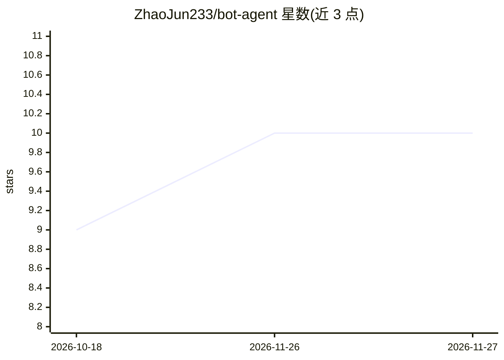

# ZhaoJun233/bot-agent

⭐ 10 · C# · MIT · 推送 2026-11-26 · [GitHub](https://github.com/ZhaoJun233/bot-agent) · 个人维护 · 中文 README

**面向 Linux 的多聊天平台 QQ/飞书 Agent 常驻服务**

基于 .NET 10 构建的无界面常驻服务，接入 QQ 私域（NapCat/OneBot v11）、QQ 官方开放平台、飞书机器人与本地演练场四类通道，与 OpenAI/Anthropic/Gemini 兼容格式的 LLM 对接，实现群聊/私聊自主研判、分层记忆、回复节奏调度与拟人化回复。配套 Vue 3 Web 管理控制台与插件市场，宿主内置 9 个系统包、13 个功能插件按需安装。支持 Docker Compose 与 1 GB 内存主机的产物镜像部署，源码基于 MIT 协议。

## 筛选速览

| 维度 | 判定 | 备注 |
|---|---|---|
| AI 角色 | `ai-native` | 本体是模型或模型工具 |
| 许可风险 | `permissive` | MIT |
| 部署形态 | `self-host` | docker 或自建部署 |
| 模型依赖 | — | README 未给出锁定关系 |
| 硬件要求 | — | 无带数字的原话,不猜 |
| 安装摩擦 | `low` | 无编译、无系统依赖或容器化 |
| 成熟度 | — | 结构信号不足 |

## 能力要点

- QQ 私域/QQ 官方/飞书/本地四类通道与多平台 RBAC、审批闭环
- 分层记忆与会话级 BM25 轻量知识库（单作用域 256 篇/4096 切片）
- 回复节奏统一调度、静默短路发送前判定
- Web 管理控制台与插件市场热装/启停/回滚

## 适用场景

- 在 QQ 群与私聊中部署具备记忆与节奏调度的聊天 Agent
- 通过飞书机器人接入团队对话场景
- 在低内存 VPS 上以 Docker 常驻运行机器人服务

## 场景标签

`聊天机器人` · 领域:对话与助手

## 证据(README 行号)

> L10: Bot Agent 是面向 Linux 环境构建的无界面、高性能、可插拔多聊天平台 Agent 常驻服务。服务支持 QQ 私域（NapCat / OneBot v11）、QQ 官方开放平台、飞书应用机器人（Feishu Bot /
> L40: - **发言时机与回复节奏统一调度**：由 新版回复节奏 统一管理 `GroupInterjectionProbability`、`GroupInterjectionCooldownSeconds`、群/私聊续话静默等待与适合度阈
> L45: - **宿主极简内置包 + 市场按需扩展**：宿主仅内置 **9 个 `system.*` 核心与平台驱动包**（4 个平台驱动包：QQ 私域、QQ 官方、飞书、本地演练场；5 个系统能力包：模型服务、内置 Agent、MCP 工

## 星数曲线

2026-10-18 9 → 2026-11-27 10（+1）

---
*卡片 v1 · prompt 1.4 · 生成 2026-11-26 · 置信度 high · 依据 README sha `756f8c2c5e84` · [字段定义](../../DATASET.md)*
