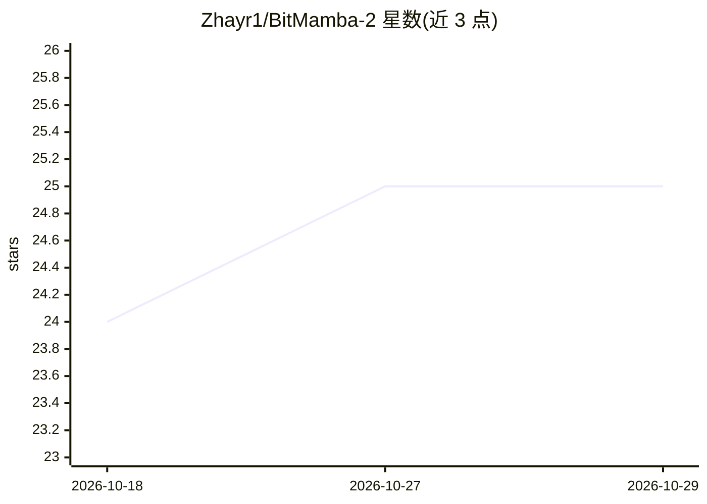

# Zhayr1/BitMamba-2

⭐ 25 · Python · MIT · 推送 2026-02-04 · [GitHub](https://github.com/Zhayr1/BitMamba-2) · [官网](https://zenodo.org/records/18394665) · 个人维护

**1.58-bit Mamba-2 状态空间模型的 JAX 预训练代码与模型**

BitMamba-2 的官方实现：将 BitNet 1.58-bit 三值量化集成进 Mamba-2 状态空间模型，在 Google Cloud TPU 上从零预训练 255M（400B tokens）与 1B（150B tokens）两个模型，权重发布于 Hugging Face。提供 JAX/Flax 训练脚本（数据流式加载 FineWeb-Edu/Cosmopedia/Stack-Dedup、梯度累积分布式训练、checkpoint 推送 HF/GCS）；推理侧由独立仓库 bitmamba.cpp 提供 CPU AVX2 优化引擎，另含 PyTorch 推理脚本。训练需在 TPU VM 上配置 HF Token 与 GCS bucket 后运行。

## 筛选速览

| 维度 | 判定 | 备注 |
|---|---|---|
| AI 角色 | `ai-native` | 本体是模型或模型工具 |
| 许可风险 | `permissive` | MIT |
| 部署形态 | `library` | 以包/库形式分发 |
| 模型依赖 | — | README 未给出锁定关系 |
| 硬件要求 | — | 无带数字的原话,不猜 |
| 安装摩擦 | `low` | 无编译、无系统依赖或容器化 |
| 成熟度 | — | 结构信号不足 |

## 能力要点

- 1.58-bit 三值量化与 Mamba-2 SSM 的混合架构
- 255M/1B 两档模型从零预训练，权重发布于 Hugging Face
- JAX/Flax 训练脚本支持 TPU 分布式训练
- 配套 C++ CPU(AVX2) 推理引擎（独立仓库）

## 适用场景

- 在 TPU 上复现或继续预训练 1.58-bit SSM 模型
- 研究低位量化与状态空间模型的结合
- 在消费级 CPU 上低内存运行 1B 模型推理

## 场景标签

`模型训练` `模型量化` · 领域:训练与推理

## 证据(README 行号)

> L9: **BitMamba-2** introduces a scalable, hybrid architecture that integrates **1.58-bit ternary quantization** (BitNet)
> L13: - **BitMamba-2-255M:** A lightweight baseline trained on 400B tokens.

## 星数曲线

2026-10-18 24 → 2026-10-29 25（+1）

---
*卡片 v1 · prompt 1.4 · 生成 2026-10-27 · 置信度 mid · 依据 README sha `4dfcdca9605b` · [字段定义](../../DATASET.md)*
