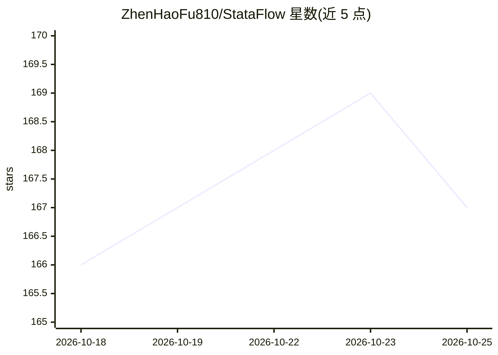

# ZhenHaoFu810/StataFlow

⭐ 167 · Python · MIT · 推送 2026-10-09 · [GitHub](https://github.com/ZhenHaoFu810/StataFlow) · [官网](https://pypi.org/project/StataFlow/) · 个人维护 · 中文 README

**面向研究者的 Stata 对齐计量经济学 Python 库**

Python 计量经济学库，提供 14 个 Stata 风格估计命令（regress、reghdfe、ivregress_2sls、logit、csdid、rdrobust 等），覆盖高维固定效应、工具变量、PPML、DID 与断点回归。双层 API：Stata 兼容命令层与 Python 原生估计层。开发以验证为先：40 个用例与 Stata 17 做系数与标准误的字段级比对（最大偏差 2.48e-7），不支持的参数会被硬性拒绝。需 Python 3.10+，核心依赖 NumPy/pandas/SciPy/scikit-learn/PyYAML；复现 Stata 验证用例需本地 Stata 17。

## 筛选速览

| 维度 | 判定 | 备注 |
|---|---|---|
| AI 角色 | `ai-native` | 本体是模型或模型工具 |
| 许可风险 | `permissive` | MIT |
| 部署形态 | `library` | 以包/库形式分发 |
| 模型依赖 | — | README 未给出锁定关系 |
| 硬件要求 | — | 无带数字的原话,不猜 |
| 安装摩擦 | `low` | 无编译、无系统依赖或容器化 |
| 成熟度 | — | 结构信号不足 |

## 能力要点

- 14 个 Stata 风格估计命令，含 reghdfe、ivreghdfe、ppmlhdfe、csdid、rdrobust
- Stata 兼容命令层与 Python 原生估计层双层 API
- 40/40 用例与 Stata 17 做系数/标准误字段级验证，最大偏差 2.48e-7
- Stata 风格自适应结果表，notebook 输出转义 HTML

## 适用场景

- 从 Stata 迁移到 Python 工作流时保持既有实证惯例
- 经济学/金融研究中做固定效应、IV、DID、RD 估计并核验与 Stata 的一致性
- 在 notebook 中生成 Stata 风格的回归结果表

## 场景标签

`金融量化` `科研工具` · 领域:学习与行业

## 证据(README 行号)

> L32: - **14 estimation commands in Python**: `regress`, `xtreg_fe`, `areg`, `reghdfe`, `ivregress_2sls`, `ivreghdfe`, `l
> L40: - **Causal inference**: BJS DID imputation, Sun-Abraham event-study interactions, Callaway-Sant'Anna DID, and sharp

## 星数曲线

2026-10-18 166 → 2026-10-25 167（+1）

---
*卡片 v1 · prompt 1.4 · 生成 2026-10-22 · 置信度 mid · 依据 README sha `e06bc7f69f13` · [字段定义](../../DATASET.md)*
