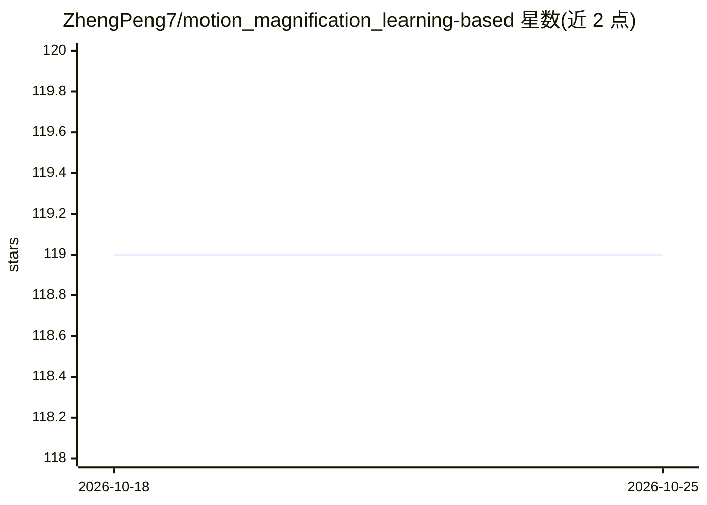

# ZhengPeng7/motion_magnification_learning-based

⭐ 119 · Python · MIT · 推送 2026-01-20 · [GitHub](https://github.com/ZhengPeng7/motion_magnification_learning-based) · 个人维护 · 中文 README

**PyTorch 复现《Learning-based Video Motion Magnification》：视频运动放大**

论文 Learning-based Video Motion Magnification 的非官方 PyTorch 复现，输入视频帧并生成运动放大后的帧，提供 Colab 在线推理 demo、notebook 离线推理与可下载权重。训练用官方合成数据集（可调规模），验证集经 ffmpeg 转帧并用脚本整理为 frameA/B/C 结构；bash run.sh 一键训练测试。与官方代码在泊松噪声、优化器参数与损失权重上存在差异，时间滤波器测试部分未实现，作者另讨论了论文中扰动正则化的数据构造问题。

## 筛选速览

| 维度 | 判定 | 备注 |
|---|---|---|
| AI 角色 | `ai-native` | 本体是模型或模型工具 |
| 许可风险 | `permissive` | MIT |
| 部署形态 | `library` | 以包/库形式分发 |
| 模型依赖 | — | README 未给出锁定关系 |
| 硬件要求 | — | 无带数字的原话,不猜 |
| 安装摩擦 | `medium` | 含编译或系统依赖之一 |
| 成熟度 | — | 结构信号不足 |

## 能力要点

- PyTorch (1.8.1~2.0) 实现的基于学习的视频运动放大
- 提供 Colab demo 与 notebook 离线推理，以及预训练权重下载
- 单卡 TITAN-Xp 约 20 小时完成 12 epoch 训练
- README 说明与官方 TensorFlow 实现的多处差异及论文数据构造问题

## 适用场景

- 放大视频中微小运动用于可视化分析
- 复现论文方法或在其基础上做研究
- 用 Colab demo 免配置快速体验运动放大效果

## 场景标签

`模型训练` `图像视频处理` · 领域:感知与多模态

## 证据(README 行号)

> L2: This is an unofficial implementation of "Learning-based Video Motion Magnification" in Pytorch (1.8.1~2.0).
> L16: *Given the video, and amplify it with only one click for all steps:*

## 星数曲线

2026-10-18 119 → 2026-10-25 119（+0）

---
*卡片 v1 · prompt 1.4 · 生成 2026-10-23 · 置信度 high · 依据 README sha `2fb304cdec52` · [字段定义](../../DATASET.md)*
