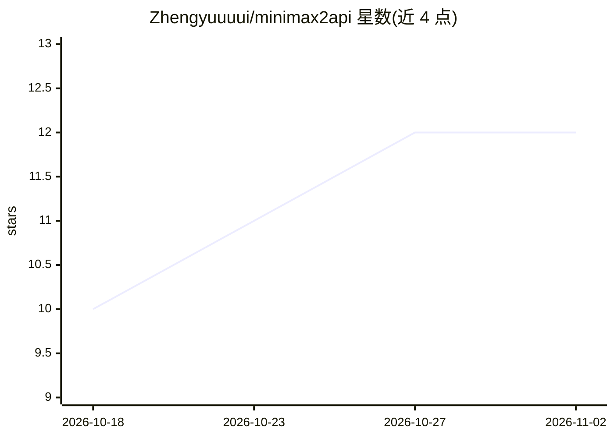

# Zhengyuuuui/minimax2api

⭐ 12 · Python · Apache-2.0 · 推送 2026-10-20 · [GitHub](https://github.com/Zhengyuuuui/minimax2api) · 个人维护 · 中文 README

**把 MiniMax Agent 网页版反代为 OpenAI/Anthropic 兼容 API 的账号池网关**

本地 API 代理服务：将 MiniMax Agent 网页版底层接口转换为 OpenAI Chat Completions 与 Anthropic Messages 协议（含 SSE 流式）。以多账号池为核心——支持浏览器 OAuth 设备码一键登录、邮箱密码批量导入、令牌粘贴、自动注册（过人机验证的完整实现不开源），配套 Token 保活、每日签到、额度刷新、代理池防风控与官方客户端指纹模拟。提供单文件 HTML 管理控制台与审计、画廊、视频生成（异步任务）板块。以 pip 依赖 + python run.py 从源码运行，默认监听 127.0.0.1:4555 且无鉴权，需置于带鉴权反代后才可外部访问。

## 筛选速览

| 维度 | 判定 | 备注 |
|---|---|---|
| AI 角色 | `ai-ecosystem` | LLM/agent 周边工具 |
| 许可风险 | `permissive` | Apache-2.0 |
| 部署形态 | `library` | 以包/库形式分发 |
| 模型依赖 | — | README 未给出锁定关系 |
| 硬件要求 | — | 无带数字的原话,不猜 |
| 安装摩擦 | `low` | 无编译、无系统依赖或容器化 |
| 成熟度 | — | 结构信号不足 |

## 能力要点

- OpenAI / Anthropic 双协议对外转换，支持流式 SSE
- 多账号池调度、故障转移、健康冷却与 Token 保活（refresh 优先、邮箱密码兜底）
- OAuth2 设备码浏览器一键登录与邮箱密码批量导入
- 代理池 + 官方客户端签名/指纹模拟防风控，管理控制台单文件 HTML

## 适用场景

- 把 MiniMax Agent 账号转成 OpenAI 兼容接口供标准客户端调用
- 多账号轮换调度以维持长期可用的本地 API 端点
- 管理账号签到、额度与保活状态

## 场景标签

`模型网关` · 领域:Agent 开发

## 证据(README 行号)

> L3: > MiniMax Agent 多账号反代网关 — 账号池调度、设备指纹对齐官方客户端、双认证路径（Web JWT / 设备流 OAuth）、浏览器一键登录、支持 OpenAI / Anthropic 协议与标准客户端。
> L115: 一个本地 API 代理服务，将 **MiniMax Agent 网页版**（`agent.minimax.io`）的底层接口转换为标准的 OpenAI / Anthropic 协议格式。
> L122: - **协议转换**：OpenAI Chat Completions + Anthropic Messages，支持流式（SSE）

## 星数曲线

2026-10-18 10 → 2026-11-02 12（+2）

---
*卡片 v1 · prompt 1.4 · 生成 2026-11-01 · 置信度 high · 依据 README sha `cbb4b619fd74` · [字段定义](../../DATASET.md)*
