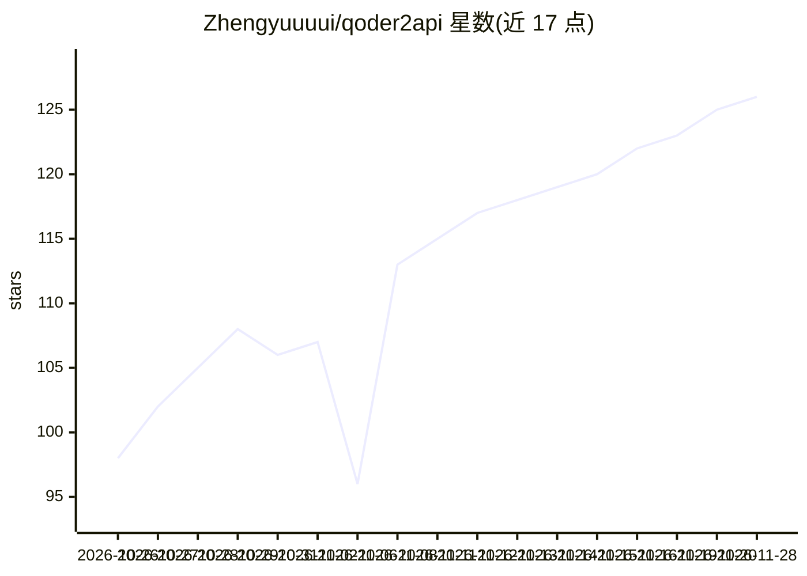

# Zhengyuuuui/qoder2api

⭐ 126 · Go · 推送 2026-11-24 · [GitHub](https://github.com/Zhengyuuuui/qoder2api) · 个人维护 · 中文 README

**将 Qoder AI 服务转为 OpenAI/Claude/Codex 兼容 API 的网关**

Go 编写的轻量级 API 网关，把 Qoder 服务的模型以 OpenAI/Claude/Codex 兼容格式对外提供，包含 Web 控制台与 Bridge 组件，适合 Linux 服务器或本地部署。功能覆盖多账号池（轮换、冷却、故障转移）、每日签到领 Credits、Token 定时续期、模型清单运行时动态拉取与显示名别名自动注册。README 另含对 Qoder Web 注册流程的协议研究文档与配套工具包，并声明仅供协议研究。

## 筛选速览

| 维度 | 判定 | 备注 |
|---|---|---|
| AI 角色 | `ai-ecosystem` | LLM/agent 周边工具 |
| 许可风险 | `none` | — |
| 部署形态 | `self-host` | docker 或自建部署 |
| 模型依赖 | — | README 未给出锁定关系 |
| 硬件要求 | — | 无带数字的原话,不猜 |
| 安装摩擦 | `low` | 无编译、无系统依赖或容器化 |
| 成熟度 | — | 结构信号不足 |

## 能力要点

- 输出 OpenAI/Claude/Codex 兼容格式 API，模型清单运行时动态拉取
- 多账号池：账号轮换、冷却、故障转移与状态持久化
- 每日签到领 100 Credits，支持 CN/Global 双区域与多时段自动签到
- Token 自动续期（15 天窗口）与模型显示名别名自动注册

## 适用场景

- 在服务器上以 OpenAI 兼容接口调用 Qoder 账号的模型额度
- 集中管理多个 Qoder 账号并自动签到、自动续期 Token
- 让只支持 OpenAI 格式的客户端接入 Qoder 上游模型

## 场景标签

`模型网关` · 领域:Agent 开发

## 证据(README 行号)

> L3: 轻量级 Qoder → OpenAI / Claude / Codex 兼容 API 网关。
> L5: 仅包含 **Web 控制台 + Bridge**，无 macOS 桌面 GUI、无 Wails、无系统托盘，适合 Linux 服务器与本地轻量部署。

## 星数曲线

2026-10-26 98 → 2026-11-28 126（+28）

---
*卡片 v1 · prompt 1.4 · 生成 2026-11-28 · 置信度 high · 依据 README sha `39d4bf01842f` · [字段定义](../../DATASET.md)*
