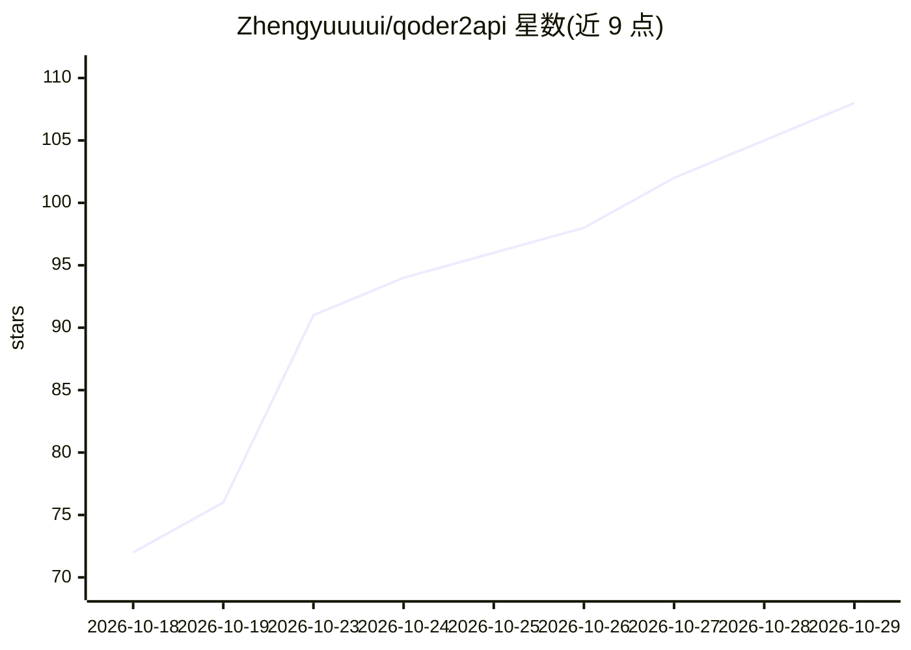

# Zhengyuuuui/qoder2api

⭐ 108 · Go · 推送 2026-10-27 · [GitHub](https://github.com/Zhengyuuuui/qoder2api) · 个人维护 · 中文 README

**将 Qoder AI 服务转为 OpenAI/Claude/Codex 兼容 API 的网关**

Go 编写的 API 网关，把 Qoder 的模型服务桥接为 OpenAI / Claude / Codex 兼容格式，仅含 Web 控制台与 Bridge，无桌面 GUI，面向 Linux 服务器与本地轻量部署。功能包括多账号池（轮换/冷却/故障转移）、每日签到领取 100 Credits（CN/Global 双区域自动路由、可自动签到）、Token 15 天自动续期、多档上下文（200K/400K/1M）展示与选择、模型排队重试，以及配置真实设备指纹后经新版推理协议解锁 Sonus/Cantus/Fast 三档模型。基于 wangtufly/QCCG 二次开发。

## 筛选速览

| 维度 | 判定 | 备注 |
|---|---|---|
| AI 角色 | `ai-ecosystem` | LLM/agent 周边工具 |
| 许可风险 | `none` | — |
| 部署形态 | `self-host` | docker 或自建部署 |
| 模型依赖 | — | README 未给出锁定关系 |
| 硬件要求 | — | 无带数字的原话,不猜 |
| 安装摩擦 | `low` | 无编译、无系统依赖或容器化 |
| 成熟度 | — | 结构信号不足 |

## 能力要点

- OpenAI / Claude / Codex 兼容 API 输出
- 多账号池：轮换、冷却、故障转移与状态持久化
- 每日签到领 Credits（CN/Global 双区域路由、多时段自动签到）
- 真实设备指纹 + 新版推理协议可解锁 Sonus / Cantus / Fast 三档模型

## 适用场景

- 在已有 OpenAI/Claude 客户端中调用 Qoder 模型
- 多个 Qoder 账号统一管理与额度/签到维护
- Linux 服务器上轻量部署自用 API 网关

## 场景标签

`模型网关` · 领域:Agent 开发

## 证据(README 行号)

> L3: 轻量级 Qoder → OpenAI / Claude / Codex 兼容 API 网关。
> L5: 仅包含 **Web 控制台 + Bridge**，无 macOS 桌面 GUI、无 Wails、无系统托盘，适合 Linux 服务器与本地轻量部署。
> L7: 本项目基于 wangtufly/QCCG **二次开发**，抽取 Bridge / 账号 / 签名核心逻辑，重做成可服务器部署的精简版本。

## 星数曲线

2026-10-18 72 → 2026-10-29 108（+36）

---
*卡片 v1 · prompt 1.4 · 生成 2026-10-23 · 置信度 high · 依据 README sha `0c16b214a9ad` · [字段定义](../../DATASET.md)*
