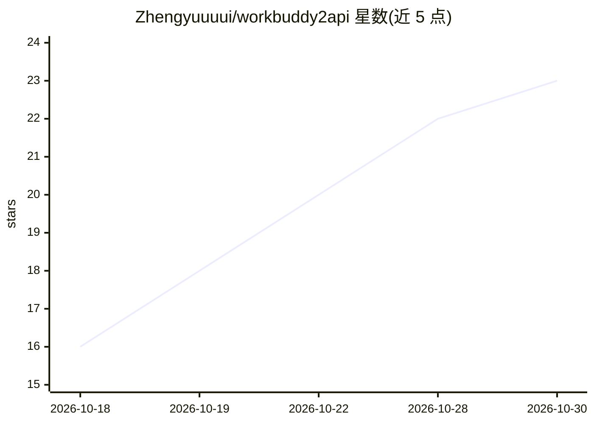

# Zhengyuuuui/workbuddy2api

⭐ 23 · Python · NOASSERTION · 推送 2026-10-20 · [GitHub](https://github.com/Zhengyuuuui/workbuddy2api) · 个人维护 · 中文 README

**CodeBuddy/WorkBuddy 反代网关：转 OpenAI/Anthropic 协议供本地客户端调用**

基于 Python 的本地 API 代理服务：将腾讯 CodeBuddy（国内）与 WorkBuddy AI（海外）的底层接口转换为 OpenAI Chat Completions、Anthropic Messages 与 Responses 三种协议端点，供 Codex CLI、Claude Code/CC Switch 等 OpenAI 兼容客户端调用。两平台共用一套代码与认证逻辑，通过启动参数切换；模拟官方客户端请求头指纹，提供多账号 session 隔离、system 消息脱敏、/v1/responses 消息压缩、额度查询与熔断状态接口。安装通过 uv 直接运行脚本，登录态保存于本地 session 文件。

## 筛选速览

| 维度 | 判定 | 备注 |
|---|---|---|
| AI 角色 | `ai-ecosystem` | LLM/agent 周边工具 |
| 许可风险 | `none` | NOASSERTION |
| 部署形态 | `None` |  |
| 模型依赖 | — | README 未给出锁定关系 |
| 硬件要求 | — | 无带数字的原话,不猜 |
| 安装摩擦 | `low` | 无编译、无系统依赖或容器化 |
| 成熟度 | — | 结构信号不足 |

## 能力要点

- 三协议端点：/v1/chat/completions、/v1/responses、/v1/messages，支持流式与工具调用
- 国内/海外双平台同一套代码，启动参数切换，模型池含 34+23 个实测可用模型
- 官方客户端请求头指纹模拟（UA、x-ide-*、会话 ID 链、b3 追踪）
- system 消息零宽空格脱敏与 /v1/responses 历史压缩（README 称可减少 60-90% token）

## 适用场景

- 让 Codex CLI / Claude Code 等客户端通过本地代理调用 CodeBuddy/WorkBuddy 模型
- 同一代理在国内 GLM/DeepSeek/Kimi 等模型与海外 GPT-5.3-Codex 之间切换
- 缓解客户端 system prompt 中品牌词/安全术语触发上游审核误拦的问题

## 场景标签

`模型网关` · 领域:Agent 开发

## 证据(README 行号)

> L18: 一个轻量级的本地 API 代理服务，将腾讯 **CodeBuddy（国内版）** 与 **WorkBuddy AI（海外版）** 的底层接口转换为标准的 OpenAI、Anthropic 和 Responses 协议格式。
> L57: - **协议转换** - 支持 OpenAI Chat Completions、Anthropic Messages API 和 Responses 三种标准格式，兼容 Codex / Claude Code / DSH 等主流客
> L321: |POST|`/v1/responses`|Responses API，兼容 Codex CLI|

## 星数曲线

2026-10-18 16 → 2026-10-30 23（+7）

---
*卡片 v1 · prompt 1.4 · 生成 2026-10-28 · 置信度 high · 依据 README sha `be8a89385bf3` · [字段定义](../../DATASET.md)*
