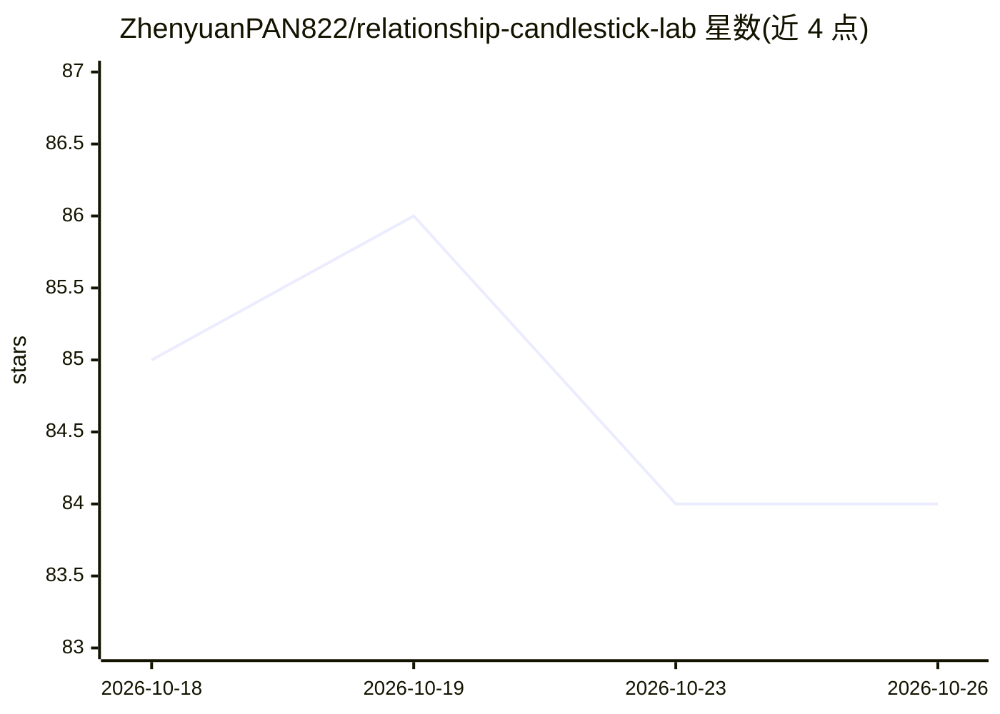

# ZhenyuanPAN822/relationship-candlestick-lab

⭐ 84 · Python · MIT · 推送 2026-05-07 · [GitHub](https://github.com/ZhenyuanPAN822/relationship-candlestick-lab) · 个人维护 · 中文 README

**把两人的聊天记录量化成关系K线走势图的分析工具**

输入两人聊天导出文件（CSV/JSON/TXT，微信、iMessage、Telegram 等均可），由 LLM 对每条消息打相对 delta 分（对比上一条与近20条氛围，10个语义维度用于归因展示），本地框架按 72 小时半衰期时间衰减递推关系指数，再聚合为多周期 OHLC K 线与成交量，附 MA/布林带/MACD/RSI/KDJ 指标与每根K线事件归因。提供两条工作流：Skill 模式（Claude Code/Codex 本地评分，数据不出本机）与 API 模式（网页直连 Anthropic/OpenAI/DeepSeek/Gemini 等厂商）。明确声明不做主观判断、不预测关系结果。

## 筛选速览

| 维度 | 判定 | 备注 |
|---|---|---|
| AI 角色 | `ai-native` | 本体是模型或模型工具 |
| 许可风险 | `permissive` | MIT |
| 部署形态 | `library` | 以包/库形式分发 |
| 模型依赖 | locked-api |  |
| 硬件要求 | — | 无带数字的原话,不猜 |
| 安装摩擦 | `low` | 无编译、无系统依赖或容器化 |
| 成熟度 | — | 结构信号不足 |

## 能力要点

- 消息级相对 delta 评分 + 时间衰减递推 + 多周期 OHLC 聚合成 K 线
- 本地 Skill 模式聊天数据全程不出本机
- 支持 Anthropic/OpenAI/DeepSeek/Gemini/通义/智谱等十余家厂商与任意 OpenAI 兼容端点
- 内置 MA/布林带/MACD/RSI/KDJ 技术指标与悬停事件归因

## 适用场景

- 把微信聊天记录导出后查看关系冷热走势图
- 回顾一段时间内冲突与修复事件对关系的影响
- 敏感对话用本地 Skill 模式分析，数据不出本机

## 场景标签

`数据分析` · 领域:效率与自动化

## 证据(README 行号)

> L13: 系统先对聊天记录里的**每一条消息**进行量化：
> L122: 3. 选厂商 + 模型，填 API Key，给聊天文件路径

## 星数曲线

2026-10-18 85 → 2026-10-26 84（-1）

---
*卡片 v1 · prompt 1.4 · 生成 2026-10-24 · 置信度 mid · 依据 README sha `188f1e5b5268` · [字段定义](../../DATASET.md)*
