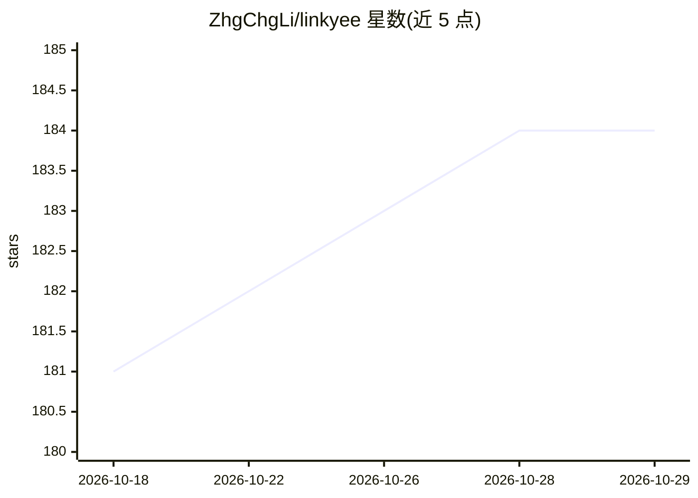

# ZhgChgLi/linkyee

⭐ 184 · JavaScript · MIT · 推送 2026-10-28 · [GitHub](https://github.com/ZhgChgLi/linkyee) · [官网](https://link.zhgchg.li/) · 个人维护 · 中文 README

**部署在 GitHub Pages 的开源自建 LinkTree 替代链接页**

基于 Liquid 模板与 Ruby 构建脚本的静态链接页生成器：点击 Use this template、编辑单一 config.yml、push 后由 GitHub Actions 构建并发布到 GitHub Pages。内置 8 套主题、6 个构建期取数的 Ruby 插件（GitHub stars/最近提交/RSS/倒计时/最新视频等）、多语言 i18n 与每日定时重建。附带两个 Claude 技能（Style Designer 与 Plugin Builder），可在 Claude Code 中用自然语言生成新主题或新插件；AI 为可选功能，去掉后链接页仍可正常构建使用。

## 筛选速览

| 维度 | 判定 | 备注 |
|---|---|---|
| AI 角色 | `ai-enhanced` | 去掉 AI 部分产品仍成立 |
| 许可风险 | `permissive` | MIT |
| 部署形态 | `self-host` | docker 或自建部署 |
| 模型依赖 | — | README 未给出锁定关系 |
| 硬件要求 | — | 无带数字的原话,不猜 |
| 安装摩擦 | `low` | 无编译、无系统依赖或容器化 |
| 成熟度 | — | 结构信号不足 |

## 能力要点

- 单一 config.yml 驱动整页，GitHub Actions 自动构建部署到 GitHub Pages
- 8 套内置主题，改一行切换，均含暗色模式与 WCAG AA 对比度
- 6 个构建期 Ruby 插件注入实时数据（stars/提交/RSS/倒计时/YouTube）
- 附带 Claude Code 技能：自然语言生成主题与插件

## 适用场景

- 想要免费自托管、无订阅的个人链接聚合页
- 在链接页展示 GitHub star 数、最新博客或最新视频等实时数据
- 通过 AI 对话定制主题样式或新增数据源插件
- 多语言读者群体的链接页

## 场景标签

 · 领域:个人网站/链接管理

## 证据(README 行号)

> L5:  A fully customized, **100% free**, open-source LinkTree alternative — deployed straight to GitHub Pages.
> L24: - **AI Style Designer.** Describe the look you want in plain English; the bundled `linkyee-style-designer` Claude s

## 星数曲线

2026-10-18 181 → 2026-10-29 184（+3）

---
*卡片 v1 · prompt 1.4 · 生成 2026-10-22 · 置信度 mid · 依据 README sha `c1a7bc637981` · [字段定义](../../DATASET.md)*
