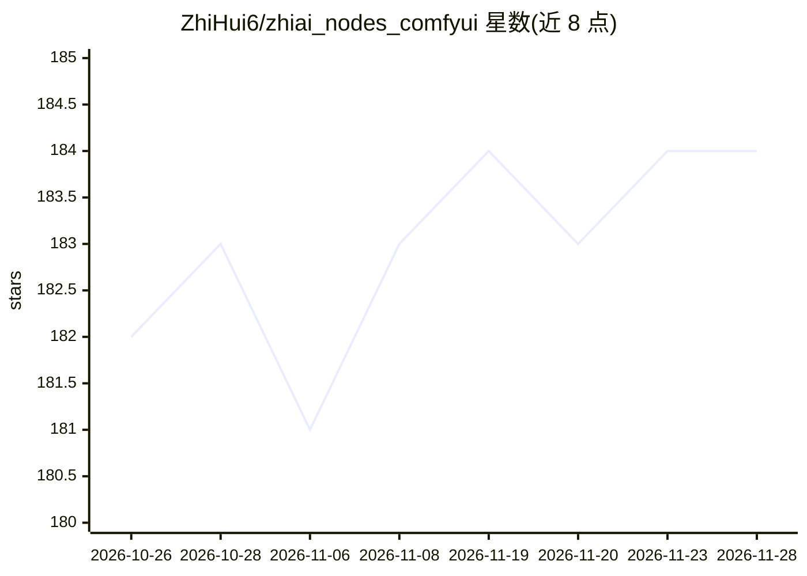

# ZhiHui6/zhiai_nodes_comfyui

⭐ 184 · JavaScript · GPL-3.0 · 推送 2026-11-23 · [GitHub](https://github.com/ZhiHui6/zhiai_nodes_comfyui) · 个人维护 · 中文 README

**ComfyUI 用户的 56 个提示词/翻译/图像处理自定义节点合集**

由 Binity 创建的 ComfyUI 自定义节点包，包含 56 个节点，分为文本处理、提示词处理、图像处理、电影后期处理、视频处理、音乐相关、Latent 处理与加载器等类别。功能涵盖多引擎翻译（免密钥免费翻译及百度、阿里云、有道、智谱AI、谷歌）、标签选择器与摄影提示词生成器等提示词工具、通过 LM Studio 本地服务器或 OpenAI 兼容在线接口的图像理解节点，以及缩放、锐化、色彩匹配等图像处理节点。自带中英双语词典，跟随 ComfyUI 语言设置切换。

## 筛选速览

| 维度 | 判定 | 备注 |
|---|---|---|
| AI 角色 | `ai-ecosystem` | LLM/agent 周边工具 |
| 许可风险 | `viral` | GPL-3.0 |
| 部署形态 | `library` | 以包/库形式分发 |
| 模型依赖 | — | README 未给出锁定关系 |
| 硬件要求 | — | 无带数字的原话,不猜 |
| 安装摩擦 | `low` | 无编译、无系统依赖或容器化 |
| 成熟度 | — | 结构信号不足 |

## 能力要点

- 56 个节点覆盖文本、提示词、图像、视频、音频、Latent 多类处理
- 多引擎翻译节点：免密钥免费翻译加 5 个可配置 API 平台
- LM Studio 本地视觉理解节点与 OpenAI 兼容在线图像理解节点
- 内置中英双语词典，随 ComfyUI 语言设置自动切换

## 适用场景

- 在 ComfyUI 工作流中快速构建与扩写 AI 绘图提示词
- 中英提示词互译与多平台翻译切换
- 通过本地 LM Studio 对图像做私有化视觉分析
- 批量图像加载、格式转换与后期锐化处理

## 场景标签

`提示工程` `图像生成` `图像视频处理` · 领域:Agent 开发

## 证据(README 行号)

> L9: 这是一个由 **Binity** 精心创建的 ComfyUI 自定义节点工具合集，旨在为用户提供一系列实用、高效的节点，以增强和扩展 ComfyUI 的功能。本节点集包含56个功能节点，涵盖文本处理、提示词优化、图像处理、翻译工具、
> L20: - 🔄 **多引擎翻译节点**：集成免密钥免费翻译与百度、阿里云、有道、智谱AI、谷歌在线共6种选择，支持中英互译，可自动识别输入语言，自由切换翻译平台。
> L44:  LM Studio节点 <code>LMStudioNode</code>

## 星数曲线

2026-10-26 182 → 2026-11-28 184（+2）

---
*卡片 v1 · prompt 1.4 · 生成 2026-11-26 · 置信度 high · 依据 README sha `aa74a315cc04` · [字段定义](../../DATASET.md)*
