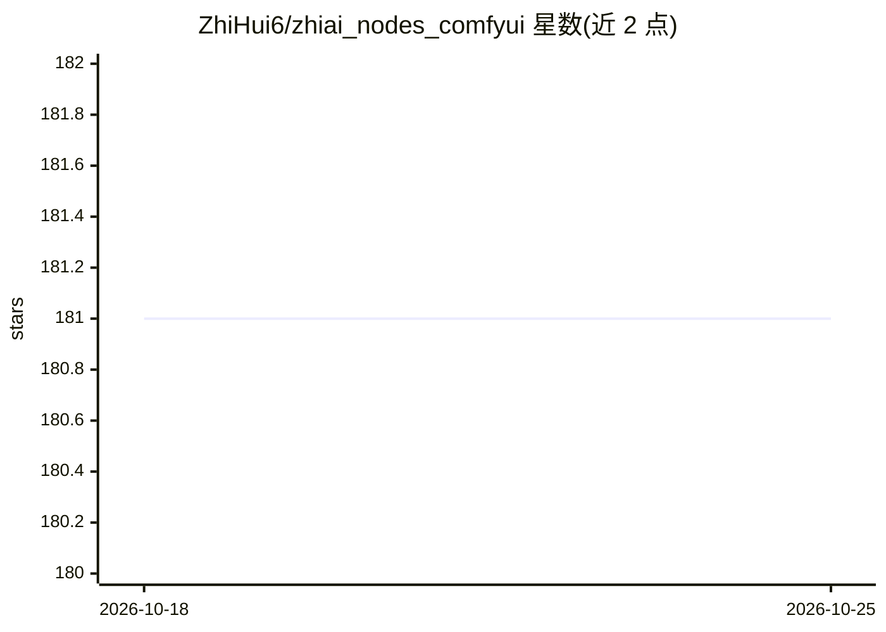

# ZhiHui6/zhiai_nodes_comfyui

⭐ 181 · JavaScript · GPL-3.0 · 推送 2026-10-21 · [GitHub](https://github.com/ZhiHui6/zhiai_nodes_comfyui) · 组织维护 · 中文 README

**55+ ComfyUI 自定义节点合集：提示词生成、翻译、图像处理**

由 Binity 创建的 ComfyUI 自定义节点包，含 55 个功能节点，覆盖文本处理（合并/替换/切换/交互编辑）、提示词工具（标签选择器、摄影/万相视频提示词生成器、Suno 歌词生成器）、多平台翻译（百度/阿里云/有道/智谱AI/谷歌）、图像处理（缩放/旋转/格式转换/锐化/胶片颗粒）、视频帧提取与预览等。AI 相关节点包括连接本地 LM Studio 的视觉理解节点与 OpenAI 兼容在线多模态接口节点。界面内置中英双语词典，随 ComfyUI 语言设置自动切换。

## 筛选速览

| 维度 | 判定 | 备注 |
|---|---|---|
| AI 角色 | `ai-ecosystem` | LLM/agent 周边工具 |
| 许可风险 | `viral` | GPL-3.0 |
| 部署形态 | `library` | 以包/库形式分发 |
| 模型依赖 | — | README 未给出锁定关系 |
| 硬件要求 | — | 无带数字的原话,不猜 |
| 安装摩擦 | `low` | 无编译、无系统依赖或容器化 |
| 成熟度 | — | 结构信号不足 |

## 能力要点

- 55 个节点覆盖文本/提示词/翻译/图像/视频/音乐辅助多类别
- LM Studio 本地视觉理解节点与 OpenAI 兼容在线多模态图像理解节点
- 内置中英双语，随 ComfyUI 语言设置切换
- 万相视频提示词生成器含 17 个维度组合

## 适用场景

- 在 ComfyUI 工作流中批量管理和组合提示词
- 通过本地或在线多模态接口做图像理解分析
- 生成摄影风格或视频提示词模板

## 场景标签

`提示工程` `图像视频处理` · 领域:Agent 开发

## 证据(README 行号)

> L9: 这是一个由 **Binity** 精心创建的 ComfyUI 自定义节点工具合集，旨在为用户提供一系列实用、高效的节点，以增强和扩展 ComfyUI 的功能。本节点集包含55个功能节点，涵盖文本处理、提示词优化、图像处理、翻译工具、
> L44:  LM Studio节点 <code>LMStudioNode</code>

## 星数曲线

2026-10-18 181 → 2026-10-25 181（+0）

---
*卡片 v1 · prompt 1.4 · 生成 2026-10-22 · 置信度 mid · 依据 README sha `52a53056fee2` · [字段定义](../../DATASET.md)*
