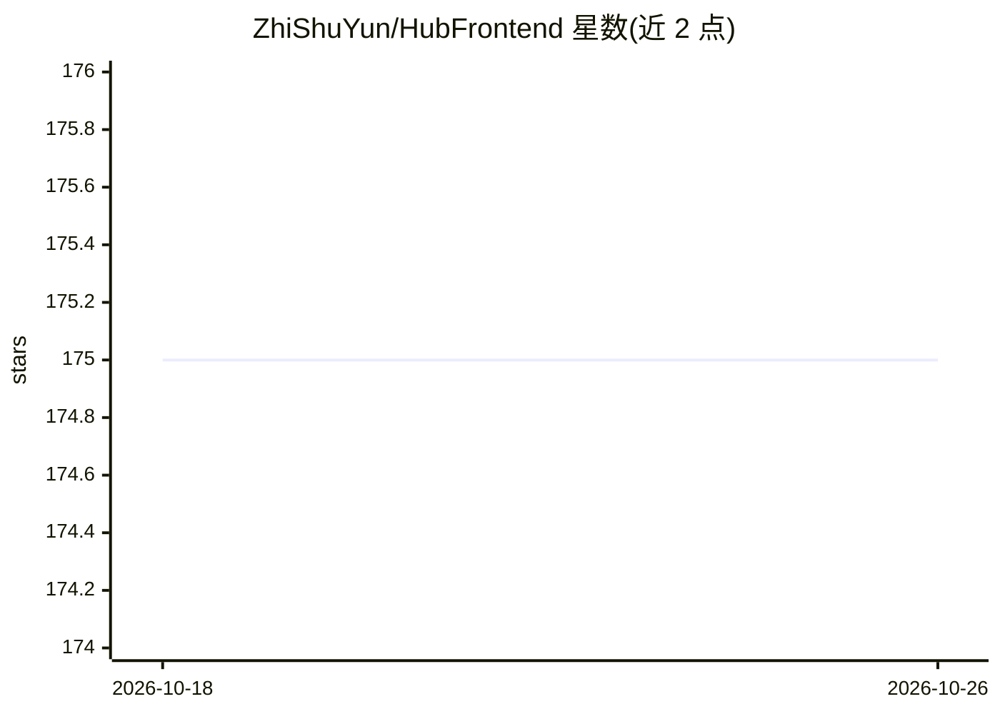

# ZhiShuYun/HubFrontend

⭐ 175 · Vue · MIT · 推送 2026-03-08 · [GitHub](https://github.com/ZhiShuYun/HubFrontend) · [官网](https://hub.zhishuyun.com) · 组织维护 · 中文 README

**集成 GPT 问答与 Midjourney 绘画的一站式 AI 服务前端系统**

基于 Vue3 的 AI 服务前端系统：接入 GPT 3.5/4.0 问答（含联网版、图像版）与 Midjourney 多通道绘图，无需自行搭建模型 API，由知数云提供服务支持。内置用户系统（微信、邮箱登录）、支付与分销系统，面向想部署自有 AI 付费服务的运营者。提供 Vercel/Netlify 一键部署及 git clone + yarn 的本地开发流程，MIT 协议可二次开发。注意：仅含前端，AI 能力依赖知数云后端服务。

## 筛选速览

| 维度 | 判定 | 备注 |
|---|---|---|
| AI 角色 | `ai-ecosystem` | LLM/agent 周边工具 |
| 许可风险 | `permissive` | MIT |
| 部署形态 | `None` |  |
| 模型依赖 | — | README 未给出锁定关系 |
| 硬件要求 | — | 无带数字的原话,不猜 |
| 安装摩擦 | `low` | 无编译、无系统依赖或容器化 |
| 成熟度 | — | 结构信号不足 |

## 能力要点

- 支持 GPT 3.5/4.0、联网版、图像版问答
- Midjourney 快速/慢速/极速多通道绘图
- 内置支付、分销与用户系统（微信/邮箱登录）
- 提供 Vercel/Netlify 一键部署，MIT 协议

## 适用场景

- 部署一个带支付的 GPT 问答与 AI 绘画服务站点
- 通过分销系统运营 AI 付费服务
- 基于 Vue3 源码二次开发自己的 AI 服务前端

## 场景标签

`聊天机器人` `图像生成` · 领域:对话与助手

## 证据(README 行号)

> L3: 集成 GPT 问答、Midjourney 绘画等一站式服务的系统，主要特点包括：
> L5: - 无需自行搭建 GPT 问答、Midjourney 服务 API，即开即用。
> L8: - 开箱支持支付和分销系统，无需任何额外配置即可利用 AI 赚钱。

## 星数曲线

2026-10-18 175 → 2026-10-26 175（+0）

---
*卡片 v1 · prompt 1.4 · 生成 2026-10-22 · 置信度 mid · 依据 README sha `eb40082526da` · [字段定义](../../DATASET.md)*
