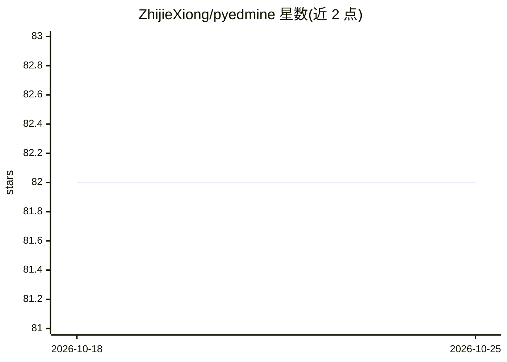

# ZhijieXiong/pyedmine

⭐ 82 · Python · MIT · 推送 2026-10-22 · [GitHub](https://github.com/ZhijieXiong/pyedmine) · [官网](https://zhijiexiong.github.io/sub-page/pyedmine/document/site/index.html) · 个人维护 · 中文 README

**教育数据挖掘代码库：知识追踪等四类模型的复现与评测**

面向研究者的教育数据挖掘（EDM）代码库，围绕知识追踪、认知诊断、习题推荐与学习路径推荐四类任务提供统一实验流程：统一数据文件格式（支持 14 个数据集）、数据预处理与划分脚本、模型训练/评估框架，共实现 28 个知识追踪模型、7 个认知诊断模型、3 个习题推荐模型与 4 个学习路径推荐模型。评估支持冷启动、无偏、多步预测等多粒度指标，另有贝叶斯优化自动调参、wandb 日志与学生知识状态可视化。必装依赖为 pandas/numpy/sklearn/torch。

## 筛选速览

| 维度 | 判定 | 备注 |
|---|---|---|
| AI 角色 | `ai-native` | 本体是模型或模型工具 |
| 许可风险 | `permissive` | MIT |
| 部署形态 | `library` | 以包/库形式分发 |
| 模型依赖 | — | README 未给出锁定关系 |
| 硬件要求 | — | 无带数字的原话,不猜 |
| 安装摩擦 | `low` | 无编译、无系统依赖或容器化 |
| 成熟度 | — | 结构信号不足 |

## 能力要点

- 实现 28 个知识追踪、7 个认知诊断、3 个习题推荐、4 个学习路径推荐模型
- 统一数据格式，内置 14 个教育数据集的处理支持
- 冷启动、无偏、多步预测、困难样本等多维度评估指标
- 贝叶斯优化自动调参、wandb 日志与知识状态变化可视化

## 适用场景

- 复现或对比教育数据挖掘领域的已有模型
- 在自己数据集上训练知识追踪/认知诊断模型并做多粒度评测
- 基于知识追踪模型作为环境模拟器研究学习路径推荐

## 场景标签

`模型训练` `推荐系统` · 领域:学习与行业

## 证据(README 行号)

> L3: PyEdmine is an **educational data mining** codebase designed for researchers, with an emphasis on ease of developmen
> L5: PyEdmine provides a unified experimental workflow for ***knowledge tracing***, ***cognitive diagnosis***, ***exercis
> L9: PyEdmine provides a code framework for training and evaluating models. Based on this framework, it implements ***28 

## 星数曲线

2026-10-18 82 → 2026-10-25 82（+0）

---
*卡片 v1 · prompt 1.4 · 生成 2026-10-24 · 置信度 high · 依据 README sha `1ddf04877805` · [字段定义](../../DATASET.md)*
