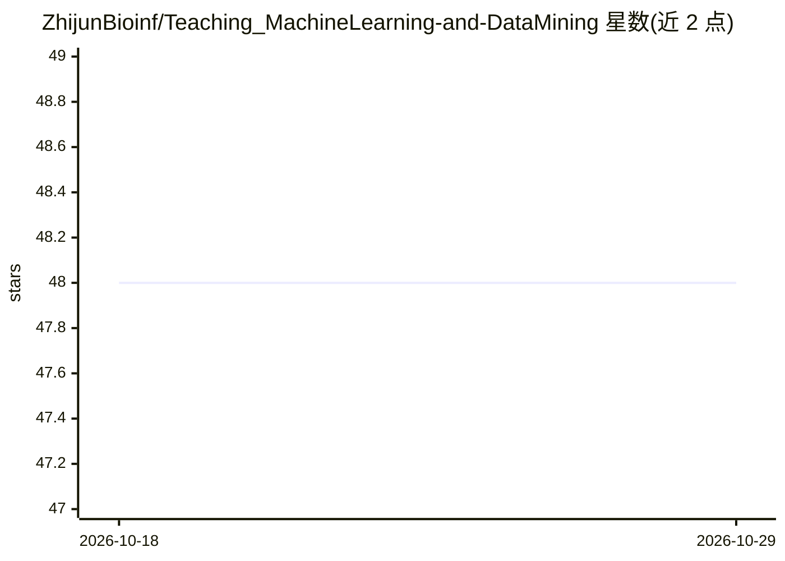

# ZhijunBioinf/Teaching_MachineLearning-and-DataMining

⭐ 48 · Jupyter Notebook · 推送 2025-12-11 · [GitHub](https://github.com/ZhijunBioinf/Teaching_MachineLearning-and-DataMining) · 个人维护 · 中文 README

**面向生信初学者的 Python 机器学习实验教学课程**

机器学习与数据挖掘实验教学仓库，以 Python 为工具，按八个实验组织内容：Python 快速入门、以 DNA 剪接位点识别为例的序列数值化与分类器（k 近邻、逻辑斯蒂回归、决策树、朴素贝叶斯、支持向量分类）、以定量构效关系建模为例的回归模型（多元线性回归、偏最小二乘、支持向量回归）、特征降维/选择，以及手写数字聚类分析。面向零基础入门生物信息学的学习者，覆盖有监督与无监督学习。

## 筛选速览

| 维度 | 判定 | 备注 |
|---|---|---|
| AI 角色 | `ai-knowledge` | 知识聚合/清单类 |
| 许可风险 | `none` | — |
| 部署形态 | `None` |  |
| 模型依赖 | — | README 未给出锁定关系 |
| 硬件要求 | — | 无带数字的原话,不猜 |
| 安装摩擦 | `low` | 无编译、无系统依赖或容器化 |
| 成熟度 | — | 结构信号不足 |

## 能力要点

- 八个渐进式实验：从 Python 入门到分类、回归、聚类
- 以 DNA 剪接位点识别与定量构效关系建模为生信案例
- 覆盖 kNN/逻辑回归/决策树/朴素贝叶斯/SVM 等常用算法
- 包含特征降维/特征选择实验

## 适用场景

- 零基础学习 Python 机器学习并完成生信经典项目
- 课程教学或自学补充实验材料
- 了解序列表征与数值化在分类建模中的应用

## 场景标签

`教程课程` · 领域:学习与行业

## 证据(README 行号)

> L3: ## 实验一：Python快速入门
> L5: ## 实验二：序列表征/数值化1(以剪接位点识别为例)
> L17: ## 实验八：无监督学习之聚类分析

## 星数曲线

2026-10-18 48 → 2026-10-29 48（+0）

---
*卡片 v1 · prompt 1.4 · 生成 2026-10-25 · 置信度 high · 依据 README sha `d7578e0c8abc` · [字段定义](../../DATASET.md)*
