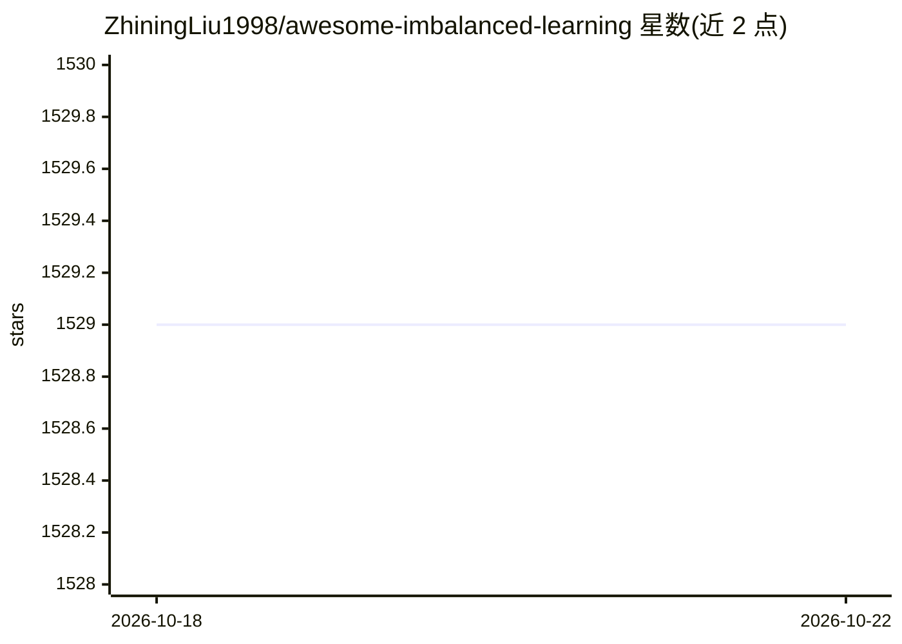

# ZhiningLiu1998/awesome-imbalanced-learning

⭐ 1,529 · CC0-1.0 · 推送 2026-06-09 · [GitHub](https://github.com/ZhiningLiu1998/awesome-imbalanced-learning) · 个人维护 · 中文 README

**类别不平衡/长尾学习领域的论文、代码与库的策展清单**

面向机器学习研究者与开发者的 awesome 类策展仓库：系统收录类别不平衡（长尾）学习方向的框架与库（按 Python/R/Java/Scala/Julia 语言分组）和研究论文（按综述、集成学习、重采样、代价敏感学习等领域分组）。条目附论文、代码、文档链接，并注明引用数等线索；作者声明清单不追求穷尽，仅保留有影响力或发表于知名会议/期刊的工作。

## 筛选速览

| 维度 | 判定 | 备注 |
|---|---|---|
| AI 角色 | `ai-knowledge` | 知识聚合/清单类 |
| 许可风险 | `viral` | CC0-1.0 |
| 部署形态 | `library` | 以包/库形式分发 |
| 模型依赖 | — | README 未给出锁定关系 |
| 硬件要求 | — | 无带数字的原话,不猜 |
| 安装摩擦 | `low` | 无编译、无系统依赖或容器化 |
| 成熟度 | — | 结构信号不足 |

## 能力要点

- 框架与库按编程语言分组（Python/R/Java/Scala/Julia）
- 论文按研究方向组织：综述、集成学习、重采样、代价敏感学习等
- 条目附论文、代码、文档链接与引用数信息
- 仅收录有影响力或发表于知名会议/期刊的工作

## 适用场景

- 查找类别不平衡/长尾学习的重采样与集成算法及其代码实现
- 调研该领域的经典综述与代表性论文
- 按语言选择可用的不平衡学习库（如 imbalanced-learn、smote_variants）

## 场景标签

`精选清单` · 领域:学习与行业

## 证据(README 行号)

> L1: Curated imbalanced learning papers, codes, and libraries
> L13: - **Frameworks** and **libraries** are grouped by *programming language*.
> L14: - **Research papers** are grouped by *research field*.

## 星数曲线

2026-10-18 1,529 → 2026-10-22 1,529（+0）

---
*卡片 v1 · prompt 1.4 · 生成 2026-10-21 · 置信度 mid · 依据 README sha `2b1bdfe11857` · [字段定义](../../DATASET.md)*
