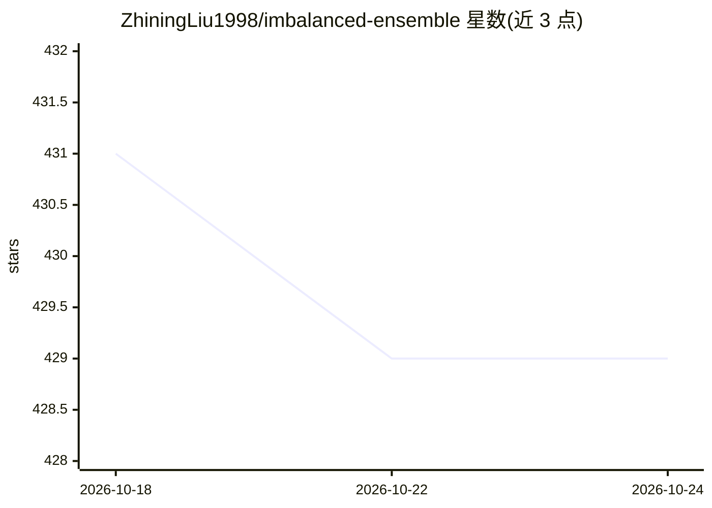

# ZhiningLiu1998/imbalanced-ensemble

⭐ 429 · Python · MIT · 推送 2026-03-05 · [GitHub](https://github.com/ZhiningLiu1998/imbalanced-ensemble) · [官网](https://imbalanced-ensemble.readthedocs.io) · 个人维护 · 中文 README

**类别不平衡/长尾分类的 Python 集成学习算法库**

面向数据科学从业者的类别不平衡学习工具箱：内置 30+ 种算法，覆盖欠采样、过采样（SMOTE 及变体）、代价敏感学习及集成方法（SelfPacedEnsemble、RUSBoost、SMOTEBagging 等）。基于 scikit-learn 设计原则，API 与 sklearn 兼容，可将二分类技术扩展到多分类。提供可视化器用于多模型对比、可定制的交互式训练日志，并基于 joblib 并行化。最初基于 imbalanced-learn 开发，现已独立演进。配套 NeurIPS 2025 表格数据类别不平衡基准（CLIMB）。

## 筛选速览

| 维度 | 判定 | 备注 |
|---|---|---|
| AI 角色 | `ai-native` | 本体是模型或模型工具 |
| 许可风险 | `permissive` | MIT |
| 部署形态 | `library` | 以包/库形式分发 |
| 模型依赖 | — | README 未给出锁定关系 |
| 硬件要求 | — | 无带数字的原话,不猜 |
| 安装摩擦 | `low` | 无编译、无系统依赖或容器化 |
| 成熟度 | — | 结构信号不足 |

## 能力要点

- 30+ 种类别不平衡分类算法（欠采样/过采样/代价敏感/集成）
- scikit-learn 风格统一 API，可与 sklearn 生态工具配合使用
- 内置多模型对比可视化器与可定制训练日志
- 将二分类技术扩展到多分类场景

## 适用场景

- 在欺诈检测、罕见药物反应预测等不平衡数据场景下训练分类模型
- 运行并对比多种不平衡学习方法的性能
- 通过训练日志与可视化监控集成训练过程

## 场景标签

 · 领域:机器学习/数据挖掘

## 证据(README 行号)

> L72: ***IMBENS* (imported as `imbens`) is an extensible Python library for quick implementation, evaluation, and compari
> L73: Currently, IMBENS includes **30+** algorithms for class-imbalanced classification, including under-sampling (select

## 星数曲线

2026-10-18 431 → 2026-10-24 429（-2）

---
*卡片 v1 · prompt 1.4 · 生成 2026-10-21 · 置信度 high · 依据 README sha `99caa22a0b45` · [字段定义](../../DATASET.md)*
