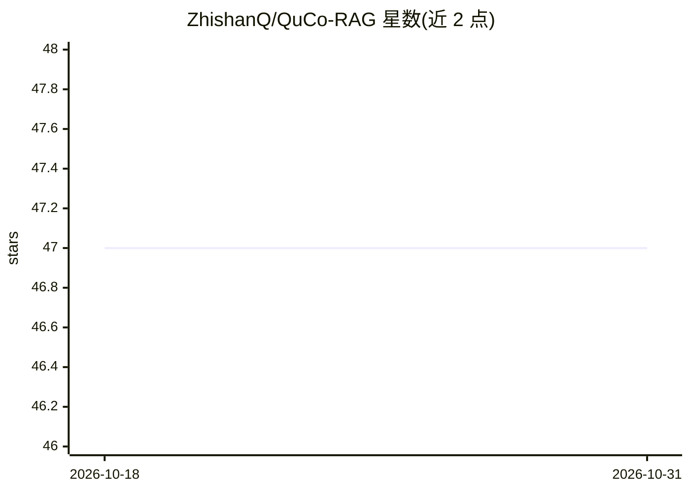

# ZhishanQ/QuCo-RAG

⭐ 47 · Python · MIT · 推送 2026-07-05 · [GitHub](https://github.com/ZhishanQ/QuCo-RAG) · [官网](https://arxiv.org/abs/2512.19134) · 组织维护

**论文官方实现：基于预训练语料统计的动态 RAG 检索触发方法**

ACL 2026 Findings 论文 QuCo-RAG 的官方代码实现：不依赖模型内部信号（logits/熵），而是用 Infini-gram 在 4 万亿 token 预训练语料中查询实体频率与共现，两阶段决定何时检索——生成前识别低频长尾实体、生成中校验共现以检测幻觉风险。方法与模型解耦，支持 OLMo、Llama、Qwen 本地模型及 GPT-4.1/gpt-5 等 API 模型，在 2WikiMultihopQA 与 HotpotQA 上评测（EM/F1），并提供 77MB 预计算缓存（提速 2-5x）与预构建 BM25 索引（约 10GB）。需自行搭建 Elasticsearch 7.17.9 并下载 Wikipedia dump。

## 筛选速览

| 维度 | 判定 | 备注 |
|---|---|---|
| AI 角色 | `ai-native` | 本体是模型或模型工具 |
| 许可风险 | `permissive` | MIT |
| 部署形态 | `library` | 以包/库形式分发 |
| 模型依赖 | local-ok | 支持本地模型 |
| 硬件要求 | `gpu-24g` | |
| 安装摩擦 | `low` | 无编译、无系统依赖或容器化 |
| 成熟度 | — | 结构信号不足 |

## 能力要点

- 基于 Infini-gram 语料统计的不确定性量化，替代模型内部信号
- 两阶段检索触发：生成前识别低频实体、生成中校验共现
- 模型无关，支持 OLMo/Llama/Qwen 本地模型与 OpenAI API 模型
- 提供预计算缓存与预构建 Elasticsearch BM25 索引

## 适用场景

- 复现论文在多跳问答数据集上的实验结果
- 运行并对比多种 RAG 基线方法（SR-RAG/FS-RAG/FL-RAG 等）
- 研究检索触发时机的动态决策机制

## 场景标签

`RAG` · 领域:知识与检索

## 证据(README 行号)

> L20: **QuCo-RAG** is a dynamic Retrieval-Augmented Generation method that determines **when to retrieve** based on objec
> L24: - 🎯 **Corpus-Grounded Uncertainty Quantification**: Uses Infini-gram to query entity frequencies and co-occurrences
> L28: - 🔄 **Model-Agnostic**: Works with OLMo, Llama, Qwen, and even GPT models

## 星数曲线

2026-10-18 47 → 2026-10-31 47（+0）

---
*卡片 v1 · prompt 1.4 · 生成 2026-10-25 · 置信度 mid · 依据 README sha `b524c740cca3` · [字段定义](../../DATASET.md)*
