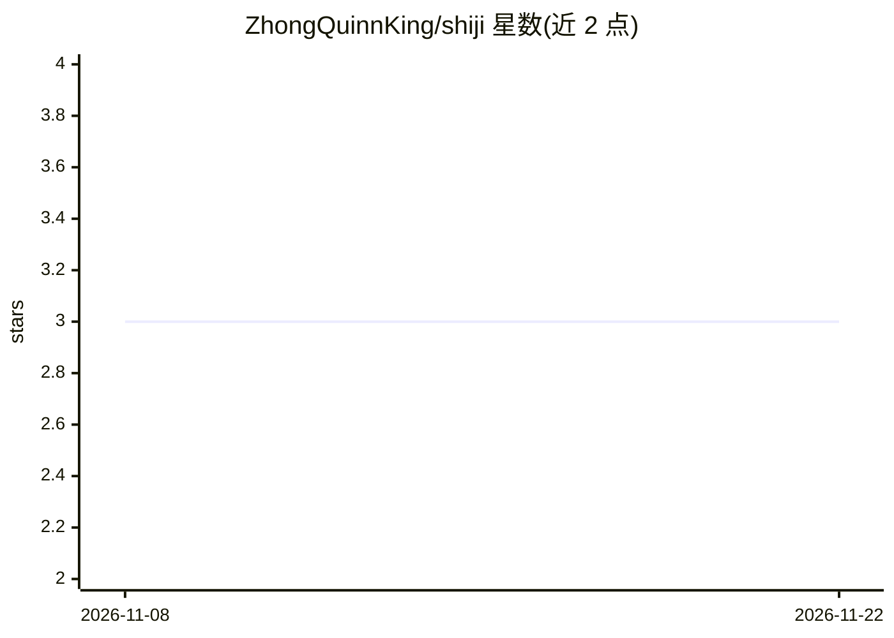

# ZhongQuinnKing/shiji

⭐ 3 · HTML · NOASSERTION · 推送 2026-10-18 · [GitHub](https://github.com/ZhongQuinnKing/shiji) · 个人维护 · 中文 README

**装进 AI 助手的高考到职场成长顾问知识包**

一个面向 AI 助手的技能（skill）包：151 篇原创指导文章按高考、大学、考研、考公、求职、职场、论文、留学等十二条线组织，AI 助手加载后按用户问题读取对应知识作答；含八套免费可打印简历模板、投递追踪表、18 题自测题。安装方式为上传豆包技能目录或 git clone 到 Claude Code 的 skills 目录；内容 CC BY-NC-ND 4.0、脚本 MIT，修改后发布需授权，商用需联系作者。

## 筛选速览

| 维度 | 判定 | 备注 |
|---|---|---|
| AI 角色 | `ai-knowledge` | 知识聚合/清单类 |
| 许可风险 | `none` | NOASSERTION |
| 部署形态 | `None` |  |
| 模型依赖 | — | README 未给出锁定关系 |
| 硬件要求 | — | 无带数字的原话,不猜 |
| 安装摩擦 | `low` | 无编译、无系统依赖或容器化 |
| 成熟度 | — | 结构信号不足 |

## 能力要点

- 十二条线 151 篇指导，从高考志愿覆盖到职场
- 访谈式生成简历并产出 HTML/PDF，附八套免费模板
- 轻档案机制：记住用户处境，下次接着聊
- 红线清单：不代笔、不做诊疗、不收集不上传数据

## 适用场景

- 高三学生问志愿填报规则和冲稳保策略
- 应届生让 AI 访谈式帮做一份可投递的简历
- 研究生问选导师、复试调剂怎么准备
- 职场新人问向上管理、劳动合同怎么看

## 场景标签

`AI 助手` · 领域:对话与助手

## 证据(README 行号)

> L54: ## 它怎么工作
> L57:  它判断问题属于哪一块，读对应的知识，给你**能落地的下一步**
> L166: **十二条线（高考 / 大学 / 考研 / 考公 / 求职 / 职场 / 论文 / 研究生 /

## 星数曲线

2026-11-08 3 → 2026-11-22 3（+0）

---
*卡片 v1 · prompt 1.4 · 生成 2026-11-22 · 置信度 high · 依据 README sha `2a29c2d7efab` · [字段定义](../../DATASET.md)*
