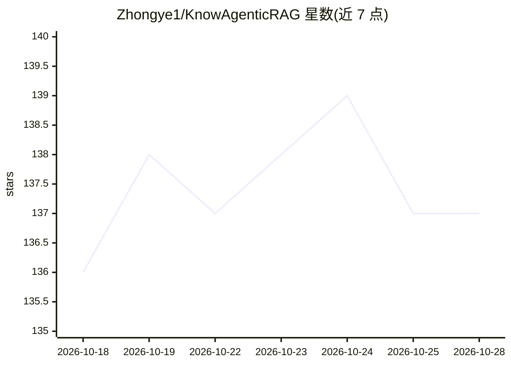

# Zhongye1/KnowAgenticRAG

⭐ 137 · Python · MIT · 推送 2026-10-16 · [GitHub](https://github.com/Zhongye1/KnowAgenticRAG) · [官网](Zhongye1.github.io/KnowAgenticRAG/index.html) · 个人维护 · 中文 README

**私有部署的多租户知识智能体平台：RAG+知识图谱+多智能体**

基于 FastAPI、React、LangGraph 的可私有部署多租户知识智能体平台：上传文档后自动解析、语义切分、向量化入 Milvus 并可抽取实体关系写入 Neo4j，检索阶段向量与 BM25 双路召回加重排；每个 Agent 可配置模型、提示词、知识挂载与工具，支持 SubAgents 并行、Skills、MCP 与隔离沙盒执行产出文件。面向需要自管数据、模型与权限的团队，提供三级角色与部门/个人共享范围治理，以及召回率、忠实度等评估指标。基于 Docker Compose 部署，需准备大模型 API Key（默认硅基流动），PDF/Office/图片解析另需 MinerU API Key。

## 筛选速览

| 维度 | 判定 | 备注 |
|---|---|---|
| AI 角色 | `ai-native` | 本体是模型或模型工具 |
| 许可风险 | `permissive` | MIT |
| 部署形态 | `self-host` | docker 或自建部署 |
| 模型依赖 | — | README 未给出锁定关系 |
| 硬件要求 | — | 无带数字的原话,不猜 |
| 安装摩擦 | `low` | 无编译、无系统依赖或容器化 |
| 成熟度 | — | 结构信号不足 |

## 能力要点

- 向量+BM25 双路召回、重排与来源引用，图谱召回与向量命中融合
- 主智能体规划、SubAgents 并行，支持 Skills/MCP/自定义工具与隔离沙盒
- 三级角色、按部门/个人共享范围、模型凭据集中配置与会话审计
- 检索（召回率/MRR）与生成（忠实度/引用准确性）双组评估，支持 Langfuse Dataset

## 适用场景

- 团队在自有基础设施上部署带权限边界的知识库问答与智能体平台
- 让文档问答的每条回答可点回原文出处并做质量评估
- 用多智能体+沙盒执行调研、数据分析并产出可下载文件

## 场景标签

`文档问答` `多智能体` `知识图谱` `模型评测` · 领域:Agent 开发

## 证据(README 行号)

> L3: **可私有部署的多租户知识智能体平台。** 知识库与 RAG、知识图谱、LangGraph 多智能体、MCP / Skills、沙盒工具与权限管理跑在同一个工作区里。文档、会话与执行轨迹留在自己的基础设施上，模型接哪家、谁能用哪些能
> L20: - Knowledge： 提供高效、精准的 Agentic RAG 套件，上传文档，解析、分块和向量索引。
> L114: 上传之后是一条自动流水线：解析、语义切分、向量化入 Milvus，需要图谱时再抽实体与关系。检索阶段向量与 BM25 双路召回，重排后把最相关的片段交给模型，回答里的来源可以点回原文。

## 星数曲线

2026-10-18 136 → 2026-10-28 137（+1）

---
*卡片 v1 · prompt 1.4 · 生成 2026-10-22 · 置信度 mid · 依据 README sha `a79bc33f21fd` · [字段定义](../../DATASET.md)*
