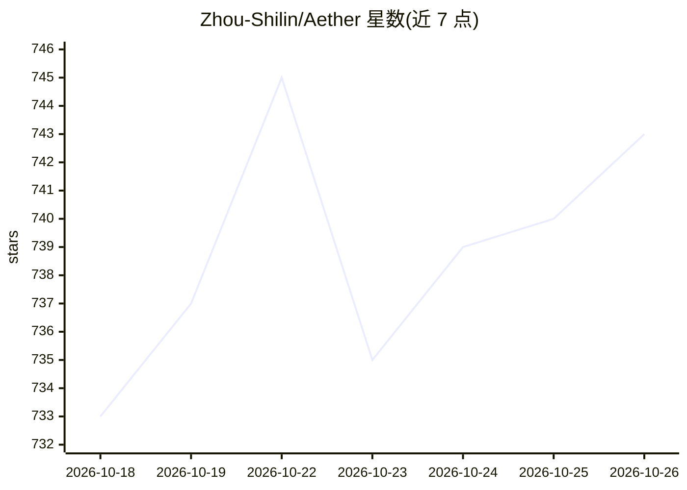

# Zhou-Shilin/Aether

⭐ 743 · Kotlin · GPL-3.0 · 推送 2026-10-25 · [GitHub](https://github.com/Zhou-Shilin/Aether) · [官网](https://aether.baimoqilin.com) · 个人维护 · 中文 README

**面向 Android/iOS/macOS 的本地通用 AI Agent 应用**

基于 Pi 框架构建的跨平台（Android、iOS、macOS）AI Agent 应用，主打本地化运行与高扩展性：原生支持加载 Pi 扩展（Web 搜索、MCP 网关、子代理等），并提供 Extension API 供扩展注入设置卡片、组件等界面元素。内置 Alpine Linux 虚拟环境以运行 shell 命令，Android 端支持系统文件管理器访问及可选的 Shizuku/Termux 集成。通过 App Store 与 GitHub Releases（APK）分发，扩展以 zip 包导入。由一名 15 岁学生业余开发，仍在持续迭代。

## 筛选速览

| 维度 | 判定 | 备注 |
|---|---|---|
| AI 角色 | `ai-native` | 本体是模型或模型工具 |
| 许可风险 | `viral` | GPL-3.0 |
| 部署形态 | `None` |  |
| 模型依赖 | — | README 未给出锁定关系 |
| 硬件要求 | — | 无带数字的原话,不猜 |
| 安装摩擦 | `low` | 无编译、无系统依赖或容器化 |
| 成熟度 | `idea` | |

## 能力要点

- 原生支持加载 Pi 扩展，附 Extension API 深度定制界面与行为
- 内置 Alpine Linux 虚拟环境，开箱运行 shell 命令与工具
- Android 端支持系统文件管理器访问 Alpine 环境与 /workspace
- 可选 Shizuku 与 Termux 集成实现设备操控与自动化

## 适用场景

- 在手机或 Mac 上使用本地化 AI Agent 对话与执行任务
- 通过导入 Pi 扩展扩展搜索、MCP、子代理等能力
- 在移动设备上运行 shell 命令与工具（Alpine VM）

## 场景标签

`AI 助手` · 领域:对话与助手

## 证据(README 行号)

> L6:  A stunning, localized, highly extensible general-purpose AI Agent for Android, iOS and macOS.
> L26: **Aether** is dedicated to bringing a modern, local AI Agent experience to mobile and desktop devices (Android, iOS

## 星数曲线

2026-10-18 733 → 2026-10-26 743（+10）

---
*卡片 v1 · prompt 1.4 · 生成 2026-10-21 · 置信度 high · 依据 README sha `9ec54c23469a` · [字段定义](../../DATASET.md)*
