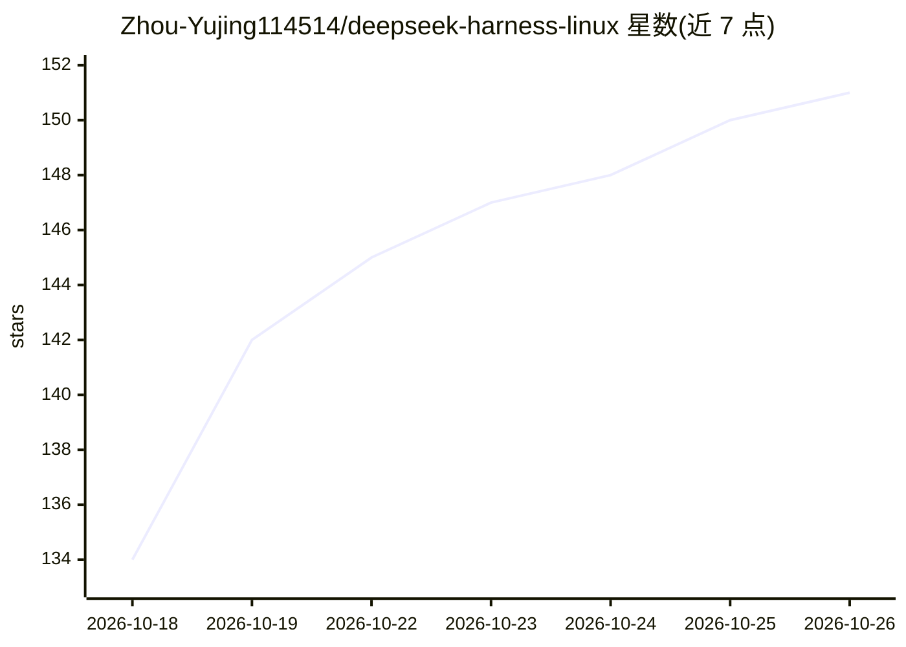

# Zhou-Yujing114514/deepseek-harness-linux

⭐ 151 · TypeScript · MIT · 推送 2026-10-25 · [GitHub](https://github.com/Zhou-Yujing114514/deepseek-harness-linux) · [官网](https://github.com/Zhou-Yujing114514/deepseek-harness-linux/releases) · 个人维护 · 中文 README

**DeepSeek Harness 桌面端的社区 Linux 打包（AppImage/.deb/.tar.gz）**

deepseek-ai/deepseek-harness 的下游 fork，专注为该桌面端补齐 Linux 打包层：在原生 CI 上产出 x64 与 arm64 的 AppImage、.deb、.tar.gz 三种安装包，AppImage 经 electron-updater 走 HTTPS 通道自动更新。agent 内核、插件体系与前端全部跟随上游，未做魔改。面向 Linux 桌面用户，数据可留本机、支持本地自托管 dsh web。已知限制：构建未签名、Office 文档转换在 Linux 暂缺、上游处于 developer preview 需持续 rebase。

## 筛选速览

| 维度 | 判定 | 备注 |
|---|---|---|
| AI 角色 | `ai-native` | 本体是模型或模型工具 |
| 许可风险 | `permissive` | MIT |
| 部署形态 | `desktop` | 安装包/桌面程序 |
| 模型依赖 | locked-api |  |
| 硬件要求 | — | 无带数字的原话,不猜 |
| 安装摩擦 | `low` | 无编译、无系统依赖或容器化 |
| 成熟度 | `idea` | |

## 能力要点

- x64/arm64 双架构三种安装包（AppImage 自动更新含 SHA256 校验）
- agent 内核与插件体系跟随上游，Linux 下保留官方桌面功能
- 可自托管运行 dsh web，数据留在本机

## 适用场景

- 在 Ubuntu/Debian/ARM 设备上安装并运行 DeepSeek 桌面客户端
- 通过 AppImage 通道自动更新桌面端
- 内网或隐私敏感环境本地自托管 DeepSeek Harness

## 场景标签

`AI 助手` · 领域:对话与助手

## 证据(README 行号)

> L3: > 给官方 DeepSeek Harness 桌面端补上**社区 Linux 桌面端打包** —— 开源（MIT）DeepSeek 桌面客户端，开箱即用的 AppImage / `.deb` / `.tar.gz`，覆盖 x64 与
> L19: - 🧩 **功能完整**：agent 内核、插件体系、联网、前端全部跟随上游，Linux 下与官方体验一致（仅 Office 文档转换暂缺）。
> L20: - 🏠 **可自托管**：本地运行 `dsh web` 或安装桌面端，数据留在本机，适合隐私敏感与内网场景。

## 星数曲线

2026-10-18 134 → 2026-10-26 151（+17）

---
*卡片 v1 · prompt 1.4 · 生成 2026-10-22 · 置信度 mid · 依据 README sha `477812f5b629` · [字段定义](../../DATASET.md)*
