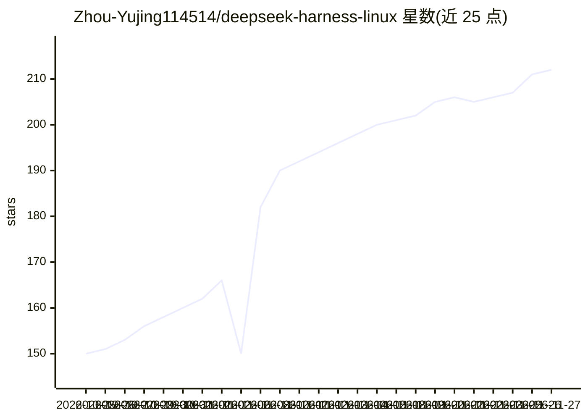

# Zhou-Yujing114514/deepseek-harness-linux

⭐ 212 · TypeScript · MIT · 推送 2026-11-24 · [GitHub](https://github.com/Zhou-Yujing114514/deepseek-harness-linux) · [官网](https://github.com/Zhou-Yujing114514/deepseek-harness-linux/releases) · 个人维护 · 中文 README

**为 DeepSeek Harness 桌面端提供 Linux 打包分发**

deepseek-ai/deepseek-harness 官方桌面端（MIT，仅发 macOS/Windows）的下游 fork，专注 Linux 移植层：通过原生 CI 为 x64/arm64 构建 AppImage、.deb、.tar.gz 三种安装包，仅 AppImage 经 electron-updater 支持 sha512 校验的自动更新。不修改上游 agent 内核与插件体系，Linux 下 Office 文档转换暂缺、构建未签名。模型能力来自 DeepSeek 官方 API，不内置离线模型。

## 筛选速览

| 维度 | 判定 | 备注 |
|---|---|---|
| AI 角色 | `ai-native` | 本体是模型或模型工具 |
| 许可风险 | `permissive` | MIT |
| 部署形态 | `desktop` | 安装包/桌面程序 |
| 模型依赖 | locked-api |  |
| 硬件要求 | — | 无带数字的原话,不猜 |
| 安装摩擦 | `low` | 无编译、无系统依赖或容器化 |
| 成熟度 | `idea` | |

## 能力要点

- 三种安装包（AppImage/.deb/.tar.gz）覆盖 x64 与 arm64
- AppImage 经 electron-updater 自动更新并做 sha512 校验
- 可自托管运行 dsh web，数据留在本机
- 改动限于 Linux 移植层，agent 内核跟随上游

## 适用场景

- 在 Ubuntu/Debian/树莓派 5 上安装 DeepSeek 桌面客户端
- 内网或隐私敏感场景自托管运行 dsh web
- ARM 服务器上的 Linux 环境使用 DeepSeek 桌面端

## 场景标签

`AI 助手` · 领域:对话与助手

## 证据(README 行号)

> L5: **一句话定位**：在 Linux 上「能下载、能装、能更新」的 DeepSeek 桌面端（DeepSeek desktop for Linux）。完整保留官方 agent / 插件 / 联网能力，既可本地自托管运行 `dsh we
> L130: > 说明：本项目是**桌面客户端**，模型能力由 DeepSeek 官方 API 提供，**不内置离线模型**，也不等同于"在本地跑模型"。如需接入自托管或第三方模型，请在客户端内自行配置对应的 API 端点与密钥。

## 星数曲线

2026-10-25 150 → 2026-11-27 212（+62）

---
*卡片 v1 · prompt 1.4 · 生成 2026-11-25 · 置信度 mid · 依据 README sha `b6dc2f6374cf` · [字段定义](../../DATASET.md)*
