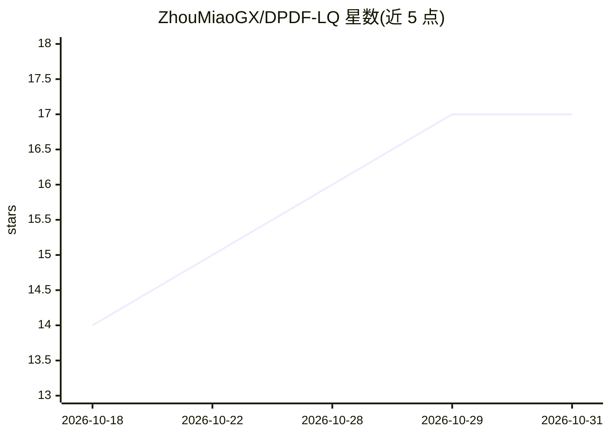

# ZhouMiaoGX/DPDF-LQ

⭐ 17 · Python · MIT · 推送 2026-02-24 · [GitHub](https://github.com/ZhouMiaoGX/DPDF-LQ) · 组织维护

**EMNLP 2025 多模态情感分析论文 DPDF-LQ 的官方代码与补充材料**

论文《Dual-Path Dynamic Fusion with Learnable Query for Multimodal Sentiment Analysis》的官方实现仓库，包含全部源代码与补充材料。模型采用双路径动态融合与可学习查询机制做多模态情感分析，默认配置使用 BERT-base 以便与基线公平对比并降低计算成本。环境要求 Python 3.10、PyTorch 2.1.0、CUDA 12.1；使用流程为克隆仓库安装依赖、下载对齐版 CMU-MOSI/CMU-MOSEI 数据集到 datasets/ 目录、运行 train.py 训练并用 TensorBoard 查看日志。面向希望复现论文实验的科研人员。

## 筛选速览

| 维度 | 判定 | 备注 |
|---|---|---|
| AI 角色 | `ai-native` | 本体是模型或模型工具 |
| 许可风险 | `permissive` | MIT |
| 部署形态 | `library` | 以包/库形式分发 |
| 模型依赖 | — | README 未给出锁定关系 |
| 硬件要求 | — | 无带数字的原话,不猜 |
| 安装摩擦 | `medium` | 含编译或系统依赖之一 |
| 成熟度 | — | 结构信号不足 |

## 能力要点

- 双路径动态融合与可学习查询的多模态情感分析模型实现
- 支持 CMU-MOSI 与 CMU-MOSEI（对齐版）数据集训练
- 默认使用 BERT-base 与基线公平对比并降低计算成本
- 训练日志可经 TensorBoard 可视化

## 适用场景

- 复现 DPDF-LQ 论文在 MOSI/MOSEI 上的实验
- 在多模态情感分析研究中作为基线或扩展起点
- 查看论文模型架构与补充材料

## 场景标签

`多模态` · 领域:感知与多模态

## 证据(README 行号)

> L3: Code and supplementary material for our EMNLP 2025 paper *Dual-Path Dynamic Fusion with Learnable Query for Multimod
> L24: Download the **aligned versions** of the CMU-MOSI and CMU-MOSEI datasets, and place them under the `datasets/` dire
> L29: python train.py --config_file configs/mosi.yaml --gpu_id 0

## 星数曲线

2026-10-18 14 → 2026-10-31 17（+3）

---
*卡片 v1 · prompt 1.4 · 生成 2026-10-29 · 置信度 mid · 依据 README sha `65a9aa7aa778` · [字段定义](../../DATASET.md)*
