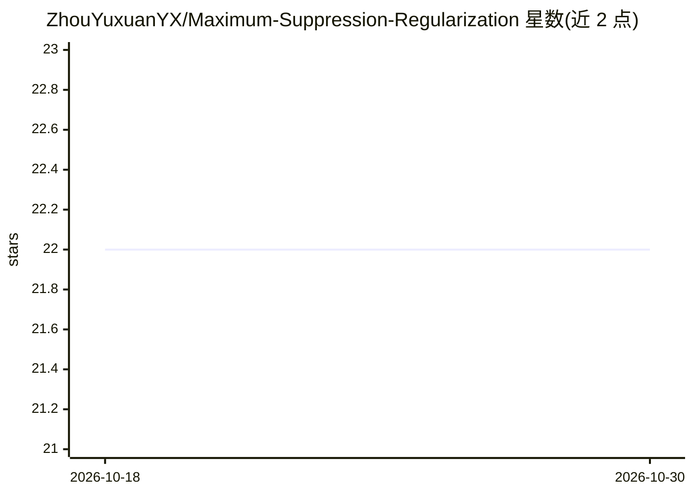

# ZhouYuxuanYX/Maximum-Suppression-Regularization

⭐ 22 · Jupyter Notebook · 推送 2025-11-06 · [GitHub](https://github.com/ZhouYuxuanYX/Maximum-Suppression-Regularization) · 组织维护

**NeurIPS 2025 论文 MaxSup 官方实现：替代标签平滑的正则化方法**

论文官方代码库，实现 MaxSup 正则化：对模型 top-1 logit 施加统一平滑惩罚（不论预测对错），以缓解标签平滑导致的类内特征坍缩与过度自信错误。提供 DeiT 框架下 ViT 训练脚本、FFCV 与常规 ResNet 训练脚本、logit 分布分析工具包，并发布 DeiT-Small 与 ResNet-50 预训练权重（ResNet 权重托管于 Hugging Face）。面向复现实验或在此基础上训练分类模型的研究者。

## 筛选速览

| 维度 | 判定 | 备注 |
|---|---|---|
| AI 角色 | `ai-native` | 本体是模型或模型工具 |
| 许可风险 | `none` | — |
| 部署形态 | `None` |  |
| 模型依赖 | — | README 未给出锁定关系 |
| 硬件要求 | — | 无带数字的原话,不猜 |
| 安装摩擦 | `low` | 无编译、无系统依赖或容器化 |
| 成熟度 | — | 结构信号不足 |

## 能力要点

- 对 top-1 logit 施加统一平滑惩罚的正则化实现
- DeiT (ViT) 与 ResNet 两条训练流水线脚本
- 提供 DeiT-Small 与 ResNet-50 预训练检查点（含 Baseline/LS 对照）
- logit 分布提取与分析可视化工具包

## 适用场景

- 复现论文中 ImageNet/长尾/细粒度分类实验
- 训练分类模型时用 MaxSup 替代标签平滑
- 下载预训练权重做下游评估或微调
- 分析模型 logit 分布特征

## 场景标签

`模型训练` · 领域:训练与推理

## 证据(README 行号)

> L3: This repository is the official implementation of NeurIPS 2025 paper (Oral Presentation).
> L5: **Max Suppression (MaxSup)** is a novel regularization technique that overcomes the shortcomings of traditional **La
> L94: We integrated MaxSup into the training pipeline for Vision Transformers using the DeiT framework.

## 星数曲线

2026-10-18 22 → 2026-10-30 22（+0）

---
*卡片 v1 · prompt 1.4 · 生成 2026-10-27 · 置信度 high · 依据 README sha `952d4acd4a15` · [字段定义](../../DATASET.md)*
