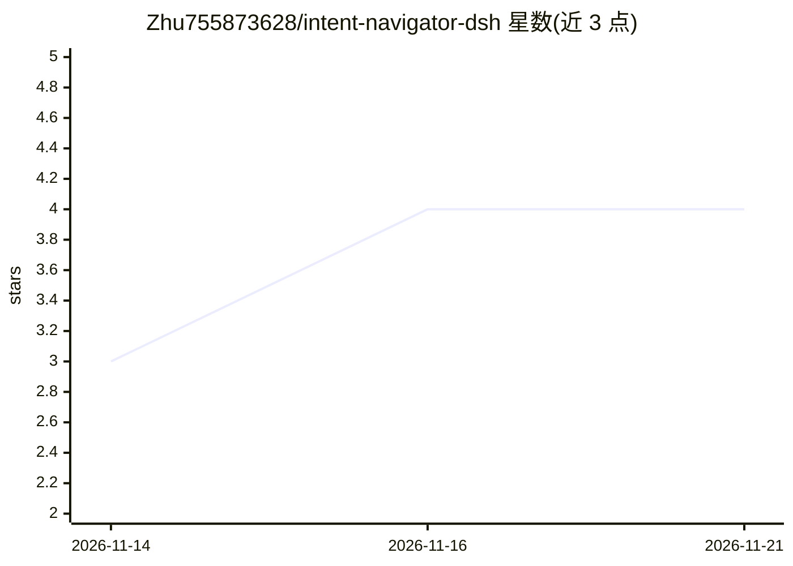

# Zhu755873628/intent-navigator-dsh

⭐ 4 · TypeScript · MIT · 推送 2026-11-10 · [GitHub](https://github.com/Zhu755873628/intent-navigator-dsh) · 个人维护

**为 DeepSeek Harness 提供意图诊断、任务简报与执行授权的插件**

DeepSeek Harness 的任务入口插件，早期实现阶段。提供任务简报工具、导航状态机、步骤前状态上下文注入，以及带副作用工具的 fail-closed 预执行授权门；授权绑定到具体简报版本，简报修订后自动失效。通过 DSH 公开扩展点实现，授权后仍透传给下游策略。当前存储为进程内存，尚无持久化 SQLite 存储，仅兼容 DSH 0.2.0-rc.2。

## 筛选速览

| 维度 | 判定 | 备注 |
|---|---|---|
| AI 角色 | `ai-ecosystem` | LLM/agent 周边工具 |
| 许可风险 | `permissive` | MIT |
| 部署形态 | `library` | 以包/库形式分发 |
| 模型依赖 | locked-api |  |
| 硬件要求 | — | 无带数字的原话,不猜 |
| 安装摩擦 | `low` | 无编译、无系统依赖或容器化 |
| 成熟度 | `idea` | |

## 能力要点

- 任务简报生成与绑定版本的执行授权机制
- 授权前对副作用或未知工具的 fail-closed 拦截门
- 简报修订后自动使既有授权失效
- 仅使用 DSH 公开扩展点，保留沙箱与审批策略权威性

## 适用场景

- 为 DSH agent 任务在执行前生成简报并获取用户授权
- 拦截未授权的副作用工具调用
- 在多步任务中注入导航状态上下文

## 场景标签

`Agent 框架` · 领域:Agent 开发

## 证据(README 行号)

> L3: Early implementation of a task-entry plugin for DeepSeek Harness. It adds task-brief tools, a navigation policy, pre
> L18: - fail-closed gate for side-effecting or unknown tools before authorization;
> L19: - pass-through to downstream DSH policies after authorization.

## 星数曲线

2026-11-14 3 → 2026-11-21 4（+1）

---
*卡片 v1 · prompt 1.4 · 生成 2026-11-21 · 置信度 high · 依据 README sha `667a14eeeb62` · [字段定义](../../DATASET.md)*
