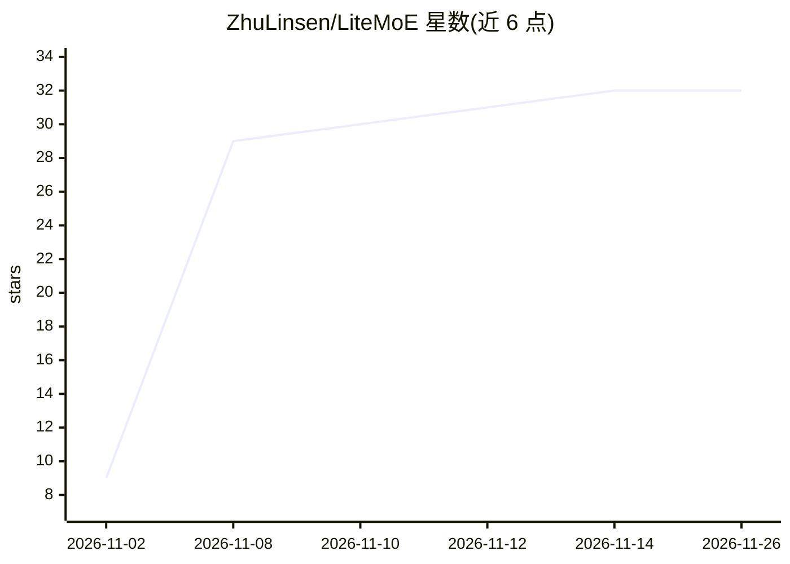

# ZhuLinsen/LiteMoE

⭐ 32 · Python · Apache-2.0 · 推送 2026-11-03 · [GitHub](https://github.com/ZhuLinsen/LiteMoE) · [官网](https://zhulinsen.github.io/LiteMoE/) · 个人维护 · 中文 README

**可读性优先的 MoE 推理引擎：约 1600 行 Python 学习用**

用约 1,600 行 Python 实现的 MoE LLM 推理引擎，调用 vLLM 的 expert/attention/router 内核，自持 forward、KV 缓存与生成循环；Decode 步骤以 CUDA Graph 运行。基准为固定批次下较 vLLM 0.32.0 提升约 5-9% 吞吐。定位是学习 MoE 推理原理与实验基础：无调度器与 serving 栈，仅支持 Granite 1B/3B、单 NVIDIA GPU、BF16、贪心解码，README 明确建议生产使用 vLLM。

## 筛选速览

| 维度 | 判定 | 备注 |
|---|---|---|
| AI 角色 | `ai-ecosystem` | LLM/agent 周边工具 |
| 许可风险 | `permissive` | Apache-2.0 |
| 部署形态 | `library` | 以包/库形式分发 |
| 模型依赖 | local-ok | 支持本地模型 |
| 硬件要求 | `gpu-8g` | |
| 安装摩擦 | `medium` | 含编译或系统依赖之一 |
| 成熟度 | — | 结构信号不足 |

## 能力要点

- 约 1,600 行 Python，从 litemoe/model.py 可通读
- 固定批次下较 vLLM 0.32.0 geomean 提升 105-111%
- 复现脚本 tools/reproduce.sh 与逐步请求追踪（token、top 5 候选、KV 增长、专家路由）
- 支持 Granite 3.1 1B（3.5GB 显存）与 3B（7.5GB）

## 适用场景

- 学习 LLM/MoE 推理的完整工作流程
- 作为小规模推理实验的代码基础
- 在单张 NVIDIA GPU 上复现吞吐基准

## 场景标签

`推理引擎` `教程课程` · 领域:学习与行业

## 证据(README 行号)

> L3:  A MoE inference engine you can read in an afternoon.
> L28: **What this does and doesn't mean:** LiteMoE calls vLLM's expert, attention and router kernels, and owns forward, K
> L46: Use vLLM for production. Use LiteMoE to learn how MoE inference works, or as a small base for experiments.

## 星数曲线

2026-11-02 9 → 2026-11-26 32（+23）

---
*卡片 v1 · prompt 1.4 · 生成 2026-11-18 · 置信度 high · 依据 README sha `cd897a06f453` · [字段定义](../../DATASET.md)*
