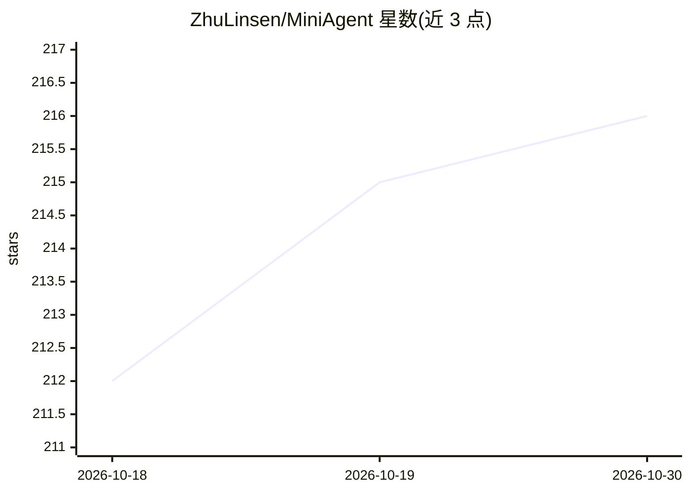

# ZhuLinsen/MiniAgent

⭐ 216 · Python · Apache-2.0 · 推送 2026-10-18 · [GitHub](https://github.com/ZhuLinsen/MiniAgent) · 个人维护 · 中文 README

**超轻量 Python Agent/Harness 框架：核心 591 行，多模型+MCP+插件**

MiniAgent 是一个可运行、可二次开发的 Python Agent 框架：核心代码集中在 agent.py、harness.py、llm.py 和 tools/registry.py 四个文件共 591 行。Harness 负责模型与工具之间的循环、插件生命周期和会话管理，支持工具调用、流式输出、上下文压缩、Skills、MCP、插件与权限控制。既可通过 CLI 直接执行编程与自动化任务（默认在修改文件和执行 Shell 前询问），也可通过 Python API 嵌入现有项目。当前为 Alpha 版本，本机执行不等于沙箱隔离。

## 筛选速览

| 维度 | 判定 | 备注 |
|---|---|---|
| AI 角色 | `ai-ecosystem` | LLM/agent 周边工具 |
| 许可风险 | `permissive` | Apache-2.0 |
| 部署形态 | `library` | 以包/库形式分发 |
| 模型依赖 | — | README 未给出锁定关系 |
| 硬件要求 | — | 无带数字的原话,不猜 |
| 安装摩擦 | `low` | 无编译、无系统依赖或容器化 |
| 成熟度 | `idea` | |

## 能力要点

- 核心仅 4 个文件 591 行，官方包共 2,135 行（含脚本可复核）
- 支持工具调用、会话记忆、上下文压缩、Skills、MCP 与插件机制
- CLI 与 Python API 双使用方式，带权限确认（--policy readonly）
- 会话可恢复，插件接入自定义工具与服务

## 适用场景

- 通过 CLI 连接模型执行编程与自动化任务
- 作为 Harness 框架嵌入现有 Python 项目开发自己的 Agent
- 通过阅读和运行少量源码学习 Agent 工作原理

## 场景标签

`Agent 框架` · 领域:Agent 开发

## 证据(README 行号)

> L12: MiniAgent 是一个**超轻量、常用功能齐备的 Python Agent / Harness**，核心仅 **591 行代码**。支持工具调用、会话记忆、上下文管理与插件扩展等主流 Agent 常用能力，**可以直接使用，也
> L17: - 🚀 **直接使用**：连接模型后即可通过 CLI 执行编程与自动化任务，也能通过 Python API 嵌入现有项目。
> L55: Harness 负责模型与工具之间的循环、插件启动和清理，以及会话管理。自己的工具、共享服务和事件监听都通过 `Plugin` 接入。插件与完整示例 →

## 星数曲线

2026-10-18 212 → 2026-10-30 216（+4）

---
*卡片 v1 · prompt 1.4 · 生成 2026-10-22 · 置信度 mid · 依据 README sha `3bcbf35fc3d1` · [字段定义](../../DATASET.md)*
