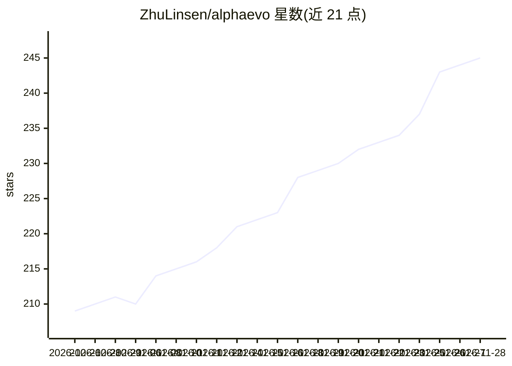

# ZhuLinsen/alphaevo

⭐ 245 · Python · Apache-2.0 · 推送 2026-11-22 · [GitHub](https://github.com/ZhuLinsen/alphaevo) · 个人维护 · 中文 README

**给量化研究者的股票策略回测与自我进化 Agent 工作室**

将交易策略表示为可读的 YAML DSL，通过 LLM 驱动的迭代进化循环生成候选策略，并以反过拟合机制约束：EvaluationKernel 执行向量化日度 MTM 回测、TrialLedger 计算 Deflated Sharpe Ratio、截面打乱零对照、锁定留存集与运行时 PIT 泄漏探测；历史回测只能否决，晋升需经 SHA-256 哈希链的前向影子账本承诺。提供零依赖本地 Web Studio、单文件 HTML 报告、CLI、STDIO MCP server 与 GitHub Actions 定时进化加 7 通道推送。依赖 Python 3.10+，数据源为 yfinance，LLM 进化路径需配置外部 provider，无 key 时回退到确定性启发式。

## 筛选速览

| 维度 | 判定 | 备注 |
|---|---|---|
| AI 角色 | `ai-native` | 本体是模型或模型工具 |
| 许可风险 | `permissive` | Apache-2.0 |
| 部署形态 | `self-host` | docker 或自建部署 |
| 模型依赖 | — | README 未给出锁定关系 |
| 硬件要求 | — | 无带数字的原话,不猜 |
| 安装摩擦 | `low` | 无编译、无系统依赖或容器化 |
| 成熟度 | — | 结构信号不足 |

## 能力要点

- YAML DSL 策略表示与逐代 YAML diff 审查
- 反过拟合闸门：DSR、打乱零对照、锁定留存集、PIT 泄漏探测
- SHA-256 哈希链前向影子账本（T+5/T+10/T+20）
- 原生 MCP server 暴露 12 个研究工具及 SKILL.md

## 适用场景

- 把自然语言交易想法转化为可回测、可审计的策略规则
- 带反过拟合闸门的参数搜索与策略进化
- 通过 GitHub Actions 每日自动进化并推送到飞书/企业微信/Telegram 等渠道
- 在 Claude Code/Cursor 等 agent 中以 MCP 工具调用策略研究能力

## 场景标签

`金融量化` · 领域:学习与行业

## 证据(README 行号)

> L5: **An Open-Source Self-Evolving Equity Strategy Research Studio, Live Arena & Anti-Delusion RSI Engine**
> L31: 4. **Ship Ready-to-Use Interfaces**: Zero-dep local **Web Studio** (`alphaevo web`), self-contained single-file **L

## 星数曲线

2026-10-26 209 → 2026-11-28 245（+36）

---
*卡片 v1 · prompt 1.4 · 生成 2026-11-25 · 置信度 high · 依据 README sha `44854cb659e8` · [字段定义](../../DATASET.md)*
