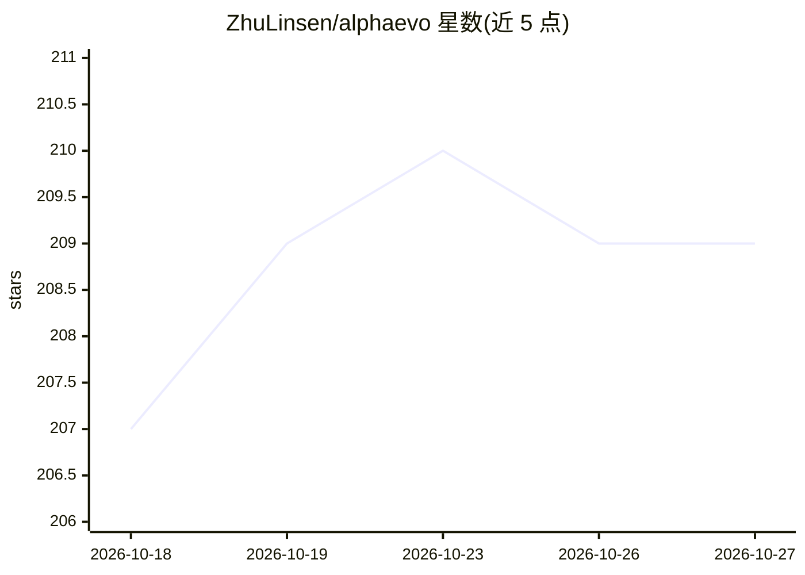

# ZhuLinsen/alphaevo

⭐ 209 · Python · Apache-2.0 · 推送 2026-07-03 · [GitHub](https://github.com/ZhuLinsen/alphaevo) · 个人维护 · 中文 README

**自我进化的股票策略研究 Agent：回测-诊断-变异-再验证闭环**

开源的股票策略研究 Agent，将 YAML 策略文件转化为研究循环：回测、LLM 失败归因、提出受控变异、重测并保留完整证据链。提供无需 API key 的确定性研究委员会路径（快照数据）与配置外部 LLM 的进化路径。内置抗过拟合机制（时间分离、Walk-Forward、复杂度惩罚、参数敏感性检验），可导出研究报告、LLM 证据与 SFT/偏好学习格式的轨迹数据。数据支持 yfinance/akshare，含 A 股工作流；CLI（Typer）驱动，pip 安装。实验性策略族（事件/轮动）标注为研究预览。

## 筛选速览

| 维度 | 判定 | 备注 |
|---|---|---|
| AI 角色 | `ai-native` | 本体是模型或模型工具 |
| 许可风险 | `permissive` | Apache-2.0 |
| 部署形态 | `library` | 以包/库形式分发 |
| 模型依赖 | — | README 未给出锁定关系 |
| 硬件要求 | — | 无带数字的原话,不猜 |
| 安装摩擦 | `low` | 无编译、无系统依赖或容器化 |
| 成熟度 | `idea` | |

## 能力要点

- LLM 引导的策略进化：失败诊断→定向变异→重测验证
- 确定性研究委员会路径无需 API key（内置冻结 yfinance 快照）
- 抗过拟合检查：时间分离、Walk-Forward、复杂度惩罚、参数扰动
- 导出 trajectory.jsonl / sharegpt.jsonl / preference.jsonl 用于训练策略研究 Agent

## 适用场景

- 让 LLM 对我的量化策略做失败诊断与迭代改进
- 无 API key 快速跑通真实数据回测 showcase
- 在 A 股数据（akshare）上研究趋势/反转策略
- 生成 SFT/偏好学习数据训练策略研究 Agent

## 场景标签

`金融量化` · 领域:学习与行业

## 证据(README 行号)

> L22: AlphaEvo is a self-evolving stock strategy research agent. It turns a readable YAML strategy into a research loop: 
> L49: - **LLM-guided strategy evolution**: diagnose failure modes, propose targeted mutations, and re-test whether the ne
> L5: **An Open-Source Self-Evolving Stock Strategy Research Agent**

## 星数曲线

2026-10-18 207 → 2026-10-27 209（+2）

---
*卡片 v1 · prompt 1.4 · 生成 2026-10-23 · 置信度 high · 依据 README sha `0a99236a58da` · [字段定义](../../DATASET.md)*
