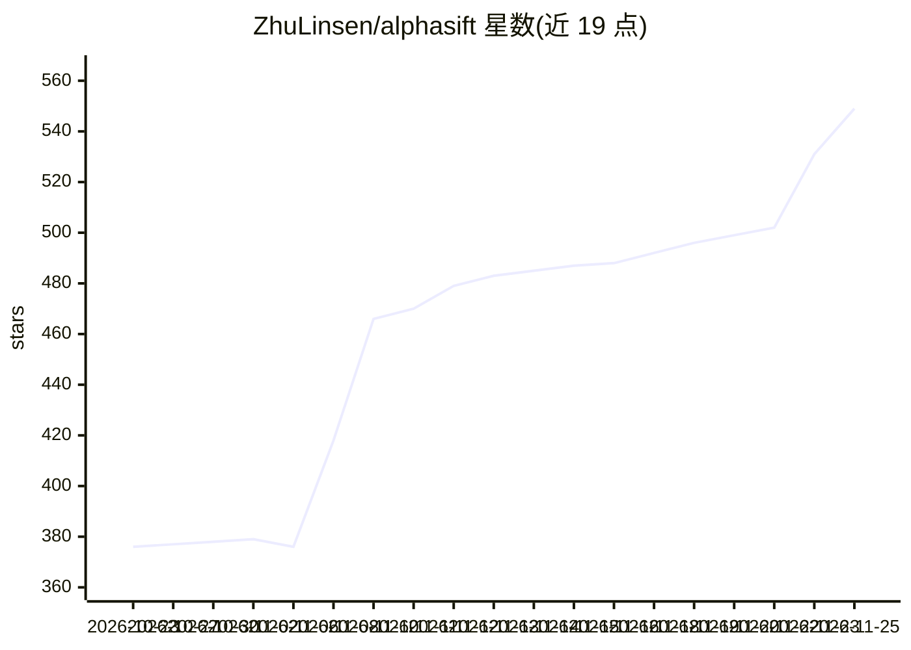

# ZhuLinsen/alphasift

⭐ 549 · Python · Apache-2.0 · 推送 2026-11-23 · [GitHub](https://github.com/ZhuLinsen/alphasift) · [官网](https://alphasift.zhulinsen.tech/) · 个人维护 · 中文 README

**面向个人投资者的 AI 量化选股引擎：每日筛选、排雷与公开胜率验证**

覆盖 A股/美股/港股/日/韩/台/印 7 市场的多因子选股系统：内置 12 套 YAML 量化策略做全市场初筛，可选接入大模型进行公告/新闻/资金流情报复核，重大利空在代码层面硬性扣分封顶；入选标的记录到公开 track-record 账本，按 T+5/T+10/T+20 核算收益验证。支持无 API Key 纯规则运行、GitHub Actions 免费定时任务、12 渠道推送，并提供 MCP Server 与本机 Web 工作台。README 声明不构成投资建议。

## 筛选速览

| 维度 | 判定 | 备注 |
|---|---|---|
| AI 角色 | `ai-native` | 本体是模型或模型工具 |
| 许可风险 | `permissive` | Apache-2.0 |
| 部署形态 | `self-host` | docker 或自建部署 |
| 模型依赖 | — | README 未给出锁定关系 |
| 硬件要求 | — | 无带数字的原话,不猜 |
| 安装摩擦 | `low` | 无编译、无系统依赖或容器化 |
| 成熟度 | — | 结构信号不足 |

## 能力要点

- 7 市场全量初筛，内置 12 套公开可读 YAML 策略与行业分散约束
- 接入大模型时注入公告/新闻/资金流上下文，重大利空代码级硬封顶 ≤35 分
- 公开 track-record 账本按 T+5/T+10/T+20 核算超额收益
- 零依赖 STDIO MCP Server（10 个只读工具）与本机 Web 工作台

## 适用场景

- 每天盘后自动筛选多市场候选股并推送到飞书/企微/Telegram 等
- 通过 Claude Code 等客户端用自然语言调用选股工具
- 核查 AI 复核与纯规则筛选的公开胜率对照
- Fork 仓库后用 GitHub Actions 零成本跑每日选股

## 场景标签

`金融量化` · 领域:学习与行业

## 证据(README 行号)

> L11: *A股 / 美股 / 港股 / 日韩台印全市场多因子筛选 → AI 情报复核与排雷 → 公开 T+N 纸面跟踪验证*
> L56: 2. **不吹票、代码级硬排雷、每天公开验真**：接入大模型时（默认 `gemini/gemini-3.8-flash` + `gemini/gemini-4-hydrogen` 自动兜底），先注入实时公告、新闻与资金流上下文，遇
> L63: 安装 AlphaSift 后，在客户端 MCP 配置加入 5 行 JSON 即可让 AI 助手直接调用 `10` 个只读量化工具（默认不触发外发推送）：

## 星数曲线

2026-10-23 376 → 2026-11-25 549（+173）

---
*卡片 v1 · prompt 1.4 · 生成 2026-11-25 · 置信度 high · 依据 README sha `d7355c00306a` · [字段定义](../../DATASET.md)*
